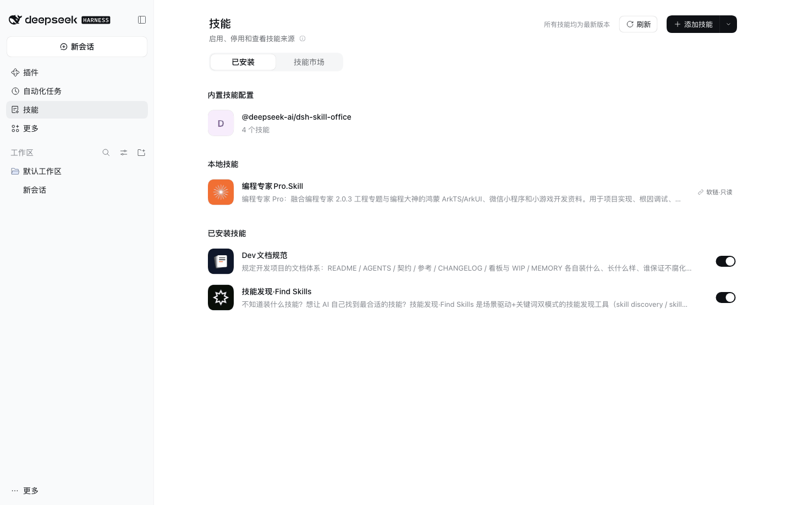
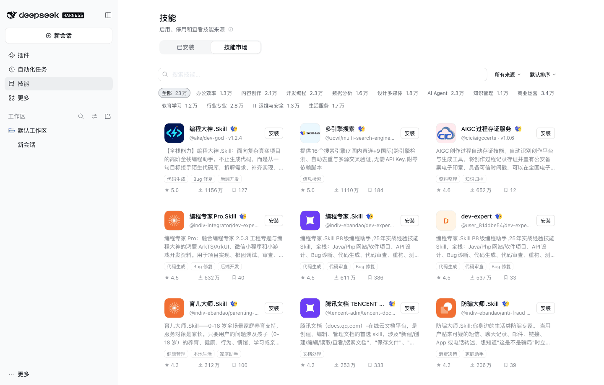

# dsh-skill-panel

English | [简体中文](README.md)

[](https://www.npmjs.com/package/@ztqing4agents/dsh-skill-panel)  
[](https://www.npmjs.com/package/@ztqing4agents/dsh-skill-panel)  
  
  
[](LICENSE)

A native-style skill management panel for the DSH (DeepSeek Harness) Web GUI.

It adds a **Skills** entry to the sidebar and gathers **built-in skills**, **local skills** and **skills installed from the market** into one view, with a skill market that reads the [SkillHub](https://skillhub.cn) mirror and supports search, install, update and on/off control.



## Features

- **Native look and feel**: layout, the sticky collapsing page header, responsive step-down, the detail page structure and the row height all follow DSH's own **Plugins** panel, so nothing looks bolted on.
- **Three sources, real grouping**: symlinks on disk, the install ledger and metadata sort skills into built-in / local / installed, and duplicate names are resolved by the host's own priority order, so what you see is the copy the model actually loads.
- **Lossless on/off control**: flipping a local or installed skill rewrites only the `disable-model-invocation` field in that skill's `SKILL.md` and keeps the original line endings (CRLF/LF), BOM, comments and line order; a built-in skill's state is stored by the plugin instead.
- **A skill market built in (SkillHub mirror)**: switch between **All sources / SkillHub / ClawHub**; debounced search, 12 category filters, multi-dimension sorting and infinite scrolling. Market installs keep their upstream icon and display name.
- **Flexible import and updates**: import a third-party skill from a local directory or a GitHub repository link (subdirectories included); market installs support automatic and manual update checks, a full overwrite upgrade and a complete uninstall.

## Requirements

- **DSH**: `>= 0.2.1`
- **Node.js**: `>= 20`
- **Network**: the market only needs `api.skillhub.cn` (the plugin requests it for you, and the browser never connects to it directly); installing also needs to reach the npm registry.

## Installation

> ℹ️ DSH reads its plugin list only at startup, so **restart DSH after every install or upgrade**.

### Option 1: desktop app (recommended)

1. Open the DSH desktop app and go to the **Plugins** page in the sidebar.
2. Click **Add plugin**, enter this package name and confirm (to install from source, use `github:Ztqing4Agents/dsh-skill-panel`):
   ```text
   @ztqing4agents/dsh-skill-panel
   ```
3. Restart the app, and **Skills** shows up in the sidebar.

*(Note: the desktop profile belongs to the Electron client, so do not touch the `desktop` profile from the command line.)*

### Option 2: CLI / custom profile

Make sure `pnpm` is on your `PATH`, then run this (`--profile` is required):

```bash
dsh plugin --profile <your-profile-name> add @ztqing4agents/dsh-skill-panel
```

*The install pulls the peer dependencies it needs from the npm registry, so keep the network up. Running the same command again is idempotent.*

## Usage

### 1. Managing installed skills

- **Browse by group**: the page lists every available skill as Built-in skills (folded by provider) → Local skills → Installed skills, each row with its own switch on the right.
- **Skill details**: click the title of any row under **Installed** to see the full `SKILL.md` body, the invocation name (selectable and copyable), the real path on disk, the source repository and the version.
- **Import a third-party skill**: click **＋ Add skill** in the toolbar, which takes three forms of input:
  - **Local directory**: for example `~/my-skills/demo-skill` (copied in full to `$DSH_HOME/skills/` once it passes validation)
  - **GitHub shorthand**: `github:owner/repo`
  - **Full GitHub link**: `https://github.com/owner/repo`, or a branch and subdirectory `https://github.com/owner/repo/tree/<branch>/<subdir>`
- Click the arrow next to the button to jump straight into the host's **Let the Agent create a skill** mode.

### 2. Skill market


- **Browse and search**: switch the data source (All sources (default, the largest) / SkillHub / ClawHub), with keyword search, category filters and sorting (default / recently updated / downloads / favorites).
- **Where it installs, and when it works**: skills go to `$DSH_HOME/skills/<name>` (default `~/.dsh/skills/<name>`), with the directory name taken from the `name` declared in the package's `SKILL.md`. **A new session can use it right away** (a session that is already open keeps its old list).
- **Updates and uninstall**: opening the **Installed** tab or a skill's detail page checks the upstream version; if there is a newer one, **Update** appears at the top right of the detail page (an update replaces the whole skill directory and keeps the enabled state); **Uninstall** removes the skill directory and the install ledger entry together.

## How it works and known limits

### Classification priority (top to bottom, first match wins)

1. **Built-in**: the source is not `filesystem`, or the skill sits in the `bundled` tier.
2. **Not shown (counted in the footer)**: skills in the project, custom-root or `user-agents` tiers.
3. **Local**: the skill directory is a symlink.
4. **Installed**: the install ledger has it, its metadata (`_skillhub_meta.json` / `_meta.json`) carries valid source information, or the directory name follows `<handle>--<slug>`.
5. **Local**: everything else that matches none of the above.

*Note: when the same skill name exists in several scopes, the panel dedupes by the host's load priority (project > runtime > user > bundled) and shows only the one that really takes effect.*

### Known limits

- **Name validation**: the host strictly requires a lowercase `kebab-case` declared name (`^[a-z0-9]+(?:-[a-z0-9]+)*$`). If a market package's `SKILL.md` declares a name with capitals, spaces or Chinese characters, the plugin refuses to install it, since the host would not load it anyway.
- **Duplicate-name protection**: if a directory with the same name already exists, the install stops and shows the path instead of overwriting silently; to change versions, remove the old directory first or use **Update** on the detail page.
- **Symlinked skills are read-only**: a symlinked local skill is tagged `symlink · read-only`, gets no switch, and the server refuses writes to it too.
- **Scope of a built-in skill's switch**: the state of a built-in skill's switch is recorded and shown only inside this panel; whether the skill is injected into the model is still up to the provider that ships it.
- **No version rollback yet**: an update is an overwrite, so going back to an older version means removing the directory and installing again.
- **Local-only security**: every backend route checks the loopback socket, the `Host` header and the browser's same-origin marker, so it can only be reached from this machine.
- **Offline affects the skill market only**: that tab shows a full-page error you can retry; the **Installed** tab keeps working.
- **Installed, but the ledger entry is missing**: when the install lands but the ledger write fails, the skill already shows under **Installed skills**, and a re-install is refused by the name check — move the directory out and install again.

## Local development

The repository ships a prebuilt `client.js`, so a normal install needs no build step. To change the front end (`src/client/**`):

```bash
# install the dev dependencies (esbuild only)
npm install

# rebuild the bundled client
npm run build
```

For local debugging, mount the plugin in a test profile's `package.json` with `"dsh-skill-panel": "link:/path/to/dsh-skill-panel"` and register it in `dsh.profile.bundles`.

## Recommended skills

Once the plugin is installed, you can try the engineering-standards skills the author maintains straight from the skill market or through **＋ Add skill**:

- **[dev-docs-standards](https://www.skillhub.cn/skills/user_7e37093e/dev-docs-standards)** ([source on GitHub](https://github.com/Ztqing4Agents/Skills/tree/main/dev-docs-standards)) — a standardised way to write and organise developer documentation, so the Agent produces technical documents with a clear structure and a consistent style (this project's README follows that standard).

## Acknowledgements

This project's development and ecosystem integration draw on the following open-source projects. Thanks to all of them:

- **[deepseek-ai/deepseek-harness](https://github.com/deepseek-ai/deepseek-harness)** — the official DSH host framework, which provides the plugin loading mechanism, the native panel interaction patterns and the underlying skill system.
- **[dsh-market/dsh-market](https://github.com/dsh-market/dsh-market)** — a DSH plugin market ecosystem project, which informed this plugin's extension mechanism and package management flow.
- **[montersy123/dsh-skill-market](https://github.com/montersy123/dsh-skill-market)** — an early skill market for DSH, which inspired how skill catalogs are aggregated and distributed.
- **[michengai/dsh-skills-manager](https://github.com/michengai/dsh-skills-manager)** — an open-source DSH skills manager, whose approach to local skill state and organisation informed this plugin.

## License

This project is open source under the [MIT](LICENSE) license.
