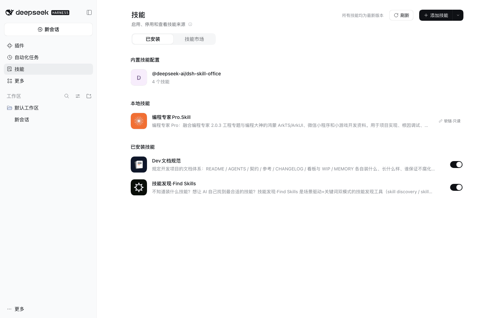
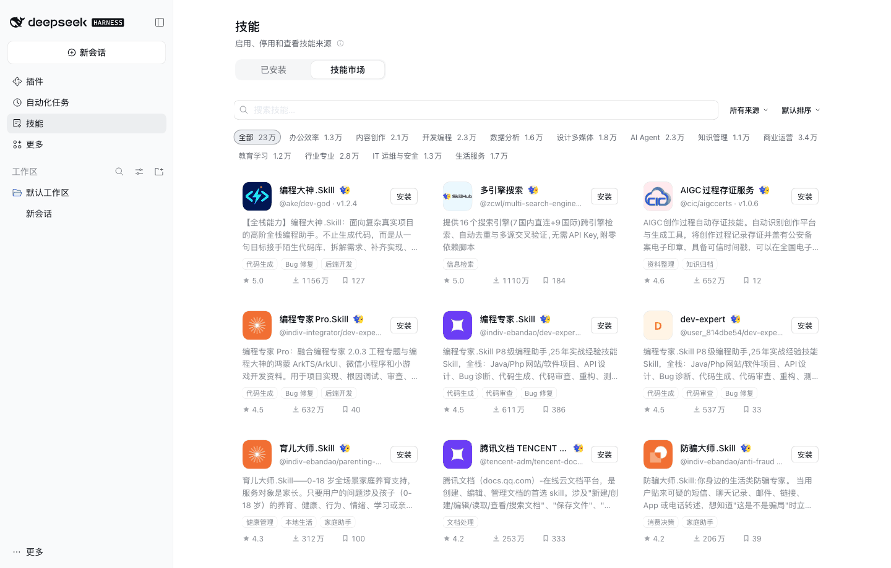

# dsh-skill-panel

**简体中文** | [English](README.en.md)

[](https://www.npmjs.com/package/@ztqing4agents/dsh-skill-panel) [](https://www.npmjs.com/package/@ztqing4agents/dsh-skill-panel) [](#安装指南)  [](LICENSE)

适用于 DSH（DeepSeek Harness）Web GUI 的原生风格技能管理面板插件。

它在侧栏提供一个「技能」入口，将 **内置技能**、**本地技能** 与 **市场安装技能** 统一收拢到同一视图中管理，并提供接入 [SkillHub](https://skillhub.cn) 镜像站的技能市场，支持一键搜索、安装、更新与启停控制。



## 核心特性

- **原生一致的交互体验**：布局、吸顶折叠页头、响应式让位、详情页结构及列表行高均对齐 DSH 原生「插件」面板，无割裂感。
- **三源合一，真实归类**：基于磁盘软链、安装台账与元数据自动区分「内置 / 本地 / 已安装」三类技能；同名技能按宿主优先级去重，确保面板展示即模型实际加载的版本。
- **无损启停控制**：切换本地或已安装技能开关时，仅精确修改目标 `SKILL.md` 中的 `disable-model-invocation` 字段，完整保留原有的换行符（CRLF/LF）、BOM、注释与行序；内置技能状态则独立持久化于插件存储中。
- **内置技能市场（SkillHub 镜像）**：支持在 **所有来源 / SkillHub / ClawHub** 间切换，提供防抖搜索、12 类标签筛选、多维度排序及无限滚动分页；市场安装技能自动继承上游图标与展示名称。
- **灵活导入与版本更新**：支持从本地目录或 GitHub 仓库链接（含子目录）导入第三方技能；市场安装的技能支持自动与手动检查更新、一键覆盖升级及彻底卸载。

## 安装指南

> ℹ️ DSH 仅在启动时读取插件列表，**所有安装或升级操作完成后均需重启 DSH 生效**。

### 方式一：桌面 App 安装（推荐）

1. 打开 DSH 桌面端，进入侧栏 **「插件」** 页面。
2. 点击 **「添加插件」**，输入以下包名并确认（要从源码装就填 `github:Ztqing4Agents/dsh-skill-panel`）：
   ```text
   @ztqing4agents/dsh-skill-panel
   ```
3. 重启应用后，侧栏将出现 **「技能」** 入口。

*(注：桌面端 Profile 由 Electron 客户端独占，请勿通过命令行操作 `desktop` Profile。)*

### 方式二：CLI / 自定义 Profile 安装

确保 `pnpm` 已加入系统 `PATH`，执行以下命令（`--profile` 为必填参数）：

```bash
dsh plugin --profile <your-profile-name> add @ztqing4agents/dsh-skill-panel
```

*安装过程中会自动从 npm registry 拉取所需的 peer dependencies，请确保网络畅通。重复执行该命令是幂等的。*

## 使用说明

### 1. 已安装技能管理

- **分区浏览**：页面按「内置技能配置（按 Provider 折叠）→ 本地技能 → 已安装技能」顺序列出所有可用技能，每行右侧提供独立开关。
- **技能详情**：点「已安装」里任一行的标题，可查看完整 `SKILL.md` 正文、调用名（可直接选中复制）、磁盘真实路径、来源仓库及版本信息。
- **导入第三方技能**：点击工具栏 **「＋ 添加技能」**，支持以下三种输入方式：
  - **本地目录**：如 `~/my-skills/demo-skill`（校验通过后整份复制至 `$DSH_HOME/skills/`）
  - **GitHub 简写**：`github:owner/repo`
  - **GitHub 完整链接**：`https://github.com/owner/repo` 或指定分支子目录 `https://github.com/owner/repo/tree/<branch>/<subdir>`
- 点击按钮旁的下拉箭头，亦可直接跳转至宿主「让 Agent 创建技能」模式。

### 2. 技能市场


- **目录浏览与检索**：支持按数据源（所有来源（默认，量最大）/ SkillHub / ClawHub）切换，配合关键词搜索、分类筛选及排序（默认 / 最近更新 / 下载量 / 收藏量）。
- **安装与生效时机**：技能默认安装至 `$DSH_HOME/skills/<name>`（默认 `~/.dsh/skills/<name>`），目录名取自包内 `SKILL.md` 声明的 `name`。**安装完成后，在新建的对话会话中即可直接调用**（当前已打开的会话仍沿用旧清单）。
- **版本更新与卸载**：进入「已安装」页签或技能详情页时会自动检查上游版本；若有更新，详情页右上角将出现 **「更新」** 按钮（更新会整体替换技能目录并保留启用状态）；点击 **「卸载」** 将同步清理技能目录与安装台账。

## 机制与已知限制

### 分区判定优先级（自上而下，首个命中即生效）

1. **内置**：来源非 `filesystem`，或属于 `bundled` 档位。
2. **不展示（计入页脚统计）**：项目级、自定义根目录或 `user-agents` 档位的技能。
3. **本地**：技能目录为符号链接（Symlink）。
4. **已安装**：命中插件安装台账、元数据文件（`_skillhub_meta.json` / `_meta.json`）包含有效来源信息，或目录名符合 `<handle>--<slug>` 规范。
5. **本地**：其余未命中上述规则的目录。

*注：跨作用域存在同名技能时，面板按宿主加载优先级（项目级 > 运行时 > 用户级 > bundled）去重，仅展示实际生效的那一条。*

### 已知边界与限制

- **命名规范校验**：宿主严格要求技能声明名为小写 `kebab-case`（`^[a-z0-9]+(?:-[a-z0-9]+)*$`）。若市场包内 `SKILL.md` 的 `name` 包含大写字母、空格或中文，插件将拒绝安装以避免宿主无法加载。
- **同名冲突保护**：若目标路径下已存在同名技能目录，安装流程会直接拦截并提示路径，不会静默覆盖；如需更换版本请先手动移除旧目录或使用详情页的「更新」功能。
- **软链技能只读**：软链引入的本地技能在面板中标记为「软链·只读」且不提供开关，服务端亦会拒绝写入操作。
- **内置技能开关作用域**：内置技能的开关状态仅在本面板内部记录与展示，是否向模型注入仍由对应的 Provider 自身控制。
- **暂不支持版本回退**：更新操作为覆盖升级，若需回退旧版需手动移除目录后重新安装。
- **本地安全策略**：所有后端路由均校验 loopback 套接字、Host 头及浏览器同源标记，仅限本机访问。
- **断网只影响技能市场**：这一页会整页报错，可以点重试；「已安装」页签完全不受影响。
- **装好了但记录没写上**：市场装完、安装记录却没写成功时，技能已经在「已安装技能」里，再装会被同名检查拦下——把目录移出去再装一次。

## 本地开发

仓库已包含预构建的 `client.js`，常规安装无需执行构建步骤。如需修改前端界面（`src/client/**`）：

```bash
# 安装开发依赖（仅包含 esbuild）
npm install

# 重新打包前端产物
npm run build
```

本地调试建议在测试 Profile 的 `package.json` 中通过 `"dsh-skill-panel": "link:/path/to/dsh-skill-panel"` 挂载，并在 `dsh.profile.bundles` 中注册该插件。

## 推荐技能

安装本插件后，可以通过技能市场或「＋ 添加技能」直接体验作者维护的工程规范类技能：

- **[dev-docs-standards](https://www.skillhub.cn/skills/user_7e37093e/dev-docs-standards)**（[GitHub 源码](https://github.com/Ztqing4Agents/Skills/tree/main/dev-docs-standards)）——一套面向开发文档的标准化编写与组织规范，帮助 Agent 输出结构清晰、风格一致的技术文档（本项目的 README 即遵循该规范撰写）。

## 致谢

本项目的开发与生态接入参考了以下优秀开源项目，在此表示感谢：

- **[deepseek-ai/deepseek-harness](https://github.com/deepseek-ai/deepseek-harness)**——DSH 官方宿主框架，提供了插件加载机制、原生面板交互范式与底层技能系统支持。
- **[dsh-market/dsh-market](https://github.com/dsh-market/dsh-market)**——DSH 插件市场生态项目，为本插件的扩展机制与包管理流程提供了参考。
- **[montersy123/dsh-skill-market](https://github.com/montersy123/dsh-skill-market)**——面向 DSH 的早期技能市场实践项目，为技能目录聚合与分发思路带来了启发。
- **[michengai/dsh-skills-manager](https://github.com/michengai/dsh-skills-manager)**——DSH 技能管理相关开源实现，为本地技能状态管理与组织方式提供了参考。

## 开源协议

本项目基于 [MIT](LICENSE) 协议开源。
