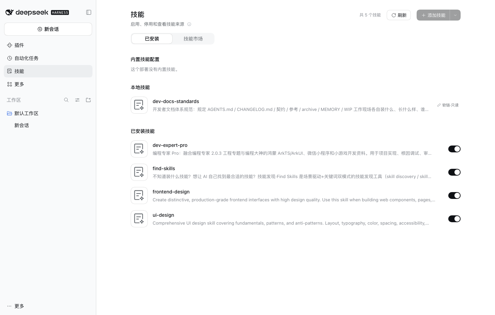

# dsh-skill-center

DSH 技能中心：一个侧栏入口 + 一页全局面板，把**内置 / 本地 / 已安装**三类技能分成三组列出来，
每行一个开关，直接启用或停用。

- **一眼分得清**：分组依据是磁盘与台账的真实证据（软链、`_meta.json`、安装台账、目录名结构），
  不是猜的；同名技能只出现一次，显示的就是模型实际会拿到的那一条。
- **开关真的生效**：本地/已安装技能改写它自己的 `SKILL.md` 里的 `disable-model-invocation`，
  其余字节一个不动（含 CRLF 行尾、BOM、注释与行序）；内置技能没有可写文件，状态存在插件自己的
  存储里，面板内即读即生效。
- **找得到也装得上**：技能市场聚合 SkillHub 与 ClawHub，搜一个词两源同时命中；一键装到 `~/.dsh/skills/`，
  装完在**新建的会话**里可用。
- **不点错东西**：「已安装」页签的行不可点击，唯一可交互控件是右侧开关；「技能市场」页签的卡片可点开详情，
  点卡片的空白处进详情、点按钮只安装。



## 安装

本包靠 `link:` 装入 profile，没有构建步骤，`client.js` 已随包入库。

```jsonc
// ~/.dsh/profiles/desktop/package.json
{
  "dependencies": { "dsh-skill-center": "link:../../Documents/Agents/Plugins/dsh-skill-center" },
  "dsh": { "profile": { "bundles": ["…", "dsh-skill-center"] } }
}
```

再在 profile 的 `node_modules` 里建一条相对软链指向包目录，然后**重启 DSH**——
bundle 列表只在启动时读取。装好后侧栏出现「技能」一行，点开就是本页。

## 页面

| 区域 | 内容 |
| --- | --- |
| 页头 | 大标题、副标题、ⓘ 说明、技能计数（`共 N 个技能，M 个已停用`）、刷新 |
| 页签 | 「已安装」/「技能市场」（市场页签见下节）；离开页签再回来，已加载的页与筛选都还在 |
| 分区 | 内置技能配置 → 本地技能 → 已安装技能，空分区也保留区标题与该区空文案 |
| 行 | 48×48 首字母彩色头像 + 名称 + 单行描述 + 右侧开关（行高 64px） |
| 页脚 | `另有 N 个技能位于项目级或其他目录，首版不展示` |

页头随滚动收拢并停靠，控件逐渐让位（先去掉按钮文字，再让页签换行）——这套行为是照宿主
「插件」页的实现搬过来的，不是另做一套。

## 技能市场

切到「技能市场」页签：一个搜索框跨两源搜索（输入停顿 250ms 后发请求，回车立即），可再按来源与分类收窄、
按推荐 / 最近更新 / 下载最多排序；滚到底自动加载下一页，两源都取尽才出现「没有更多了」。
点卡片的**空白处**看详情（概览 + 事实表 + 包内文件清单），「返回市场」回到原来的滚动位置与已加载页数。

**装到哪**：`$DSH_HOME/skills/<name>`（默认 `~/.dsh/skills/<name>`），与手装技能同一位置，由 Harness 自己的
技能系统发现。`<name>` 取自技能包 `SKILL.md` 里声明的 `name`，**不是市场里显示的名字**——所以会出现
「市场里叫 A、目录叫 B」，详情页的「安装到」一行就是最终路径。

**什么时候生效**：**新建的会话**里可用。当前会话仍用它已经加载的技能清单，所以装完不会立刻出现在当前对话里
（面板也不会说「立即生效」或「请重启」）。

**同名怎么办**：本机已有同名目录时一律拒绝安装，提示里给出完整路径，**没有覆盖入口**。要换版本得先把旧目录
移出 `~/.dsh/skills/`，再回来安装。

**为什么有的技能装不了**：宿主的技能名语法是 `^[a-z0-9]+(?:-[a-z0-9]+)*$`（小写字母、数字、单个连字符分段），
声明名是 `Design`、带空格或中文的包**一律拒绝安装**——不是本插件保守，是宿主即使硬装进去也不会加载它。
出路只有两条：等作者改名，或自己装好后手动把 `SKILL.md` frontmatter 的 `name` 改成合规值并改目录名。

## 三分区怎么判

首个命中即定，顺序不可换：

| 序 | 条件 | 结论 |
| --- | --- | --- |
| R1 | 来源不是 `filesystem` | 内置 |
| R2 | `filesystem` 但在 bundled 档 | 内置 |
| R3 | 项目级 / 自定义根 / user-agents 档 | 本版不展示（计入页脚） |
| R4 | 目录是**软链** | 本地 |
| R5 | 安装台账命中 | 已安装 |
| R6 | `_skillhub_meta.json` / `_meta.json` 带 `source` | 已安装 |
| R7 | `_meta.json` 同时有 `ownerId` + `slug` | 已安装 |
| R8 | 目录名 `<handle>--<slug>` 且后缀等于声明名 | 已安装（中置信） |
| R9 | 其余 | 本地 |

同名跨分区只显示一次，按**档位数值小者胜**（100 项目级 < 200 < 250 运行时 < 300 < 400 用户 < 500 < 600 bundled）。
理由只有一条：面板显示的必须是模型实际拿到的那一条。

## 已知限制

- **软链技能只读**：不渲染开关，改渲染「软链·只读」标记；即使有人直接打接口，服务端也会返回
  `409 E_SYMLINK_READONLY` 且不写任何字节。
- **内置技能的开关只在本面板内生效**：注册表不感知这份状态，模型是否仍收到该技能取决于提供它的
  provider。面板如实说明，不假装改动了别处。
- **「＋ 添加技能」是禁用态**：安装流程在后续版本，本版点击给「即将支持」。
- **市场是网络功能**：离线或上游不可达时，市场页签进整页错误态（可重试），「已安装」页签完全不受影响；
  只有一个源连不上时，另一个源的结果照常渲染，顶部一条提示说明哪个源连不上。
- **ClawHub 的搜索接口没有翻页**：关键词搜索里 ClawHub 只给第一页；浏览（不搜）时两源都能继续翻。
- **分类只有 SkillHub 提供**：选中某个分类后 ClawHub 条目不在结果里，筛选栏会明示这一点；来源选 ClawHub 时
  分类行直接隐藏。
- **图标只有 SkillHub 给**：卡片与详情显示上游图标（约四成条目有），没有图标的用技能名首字母头像；
  ClawHub 返回的「图标」是一串 lucide 图标名而不是图片地址，本版不渲染，同样回落首字母头像。
- **卡片只显示下载量**：不显示安装数（两源的统计口径不同，同屏会误导）；缺失的值整段不渲染，不会显示成 0。
- **装完若台账写入失败**：目录会在、面板却显示「未安装」，此时再装会被同名检查拦下；把目录移出
  `~/.dsh/skills/` 后重装即可。
- **没有更新、回退、卸载、收藏、评分与安全标记**：本轮只做「发现 → 安装」，装好的技能请用「已安装」页签管理
  开关，用文件管理器管理增删。
- **详情里的文件清单可能不全**：ClawHub 的包读取失败时技能仍按原清单安装，详情可能少列几行（P1 会在该行明示）。
- **包声明名不合规就不能装**：见上节说明——宿主技能名是小写 kebab-case，`Design` / 带空格 / 中文名一律拒绝，
  本插件不改名、不用 slug 顶替。
- **不显示版本、不做更新检查**：页头状态是计数，不是「均为最新版本」。
- 写路由只接受面板展示过的 `(名称, 路径)`：执行前重新扫描，路径不完全一致即 `409 E_STALE_PATH`，
  软链、越界、无 frontmatter 一律拒绝。
- 所有路由仅限本机（loopback 套接字 + Host 头 + 浏览器同源标记，带转发头一律否决）。

## 要求

- DSH `>= 0.2.1`，Node `>= 20`。
- 技能市场需要访问 `api.skillhub.cn` 与 `clawhub.ai`（经本插件的 Host 代理转发，浏览器不直连）。
  网络受限时市场页签会显示连不上，「已安装」页签与开关功能照常。
- 运行时零依赖；`esbuild` 只在重新构建 `client.js` 时需要。

## 许可

BSD-3-Clause。
