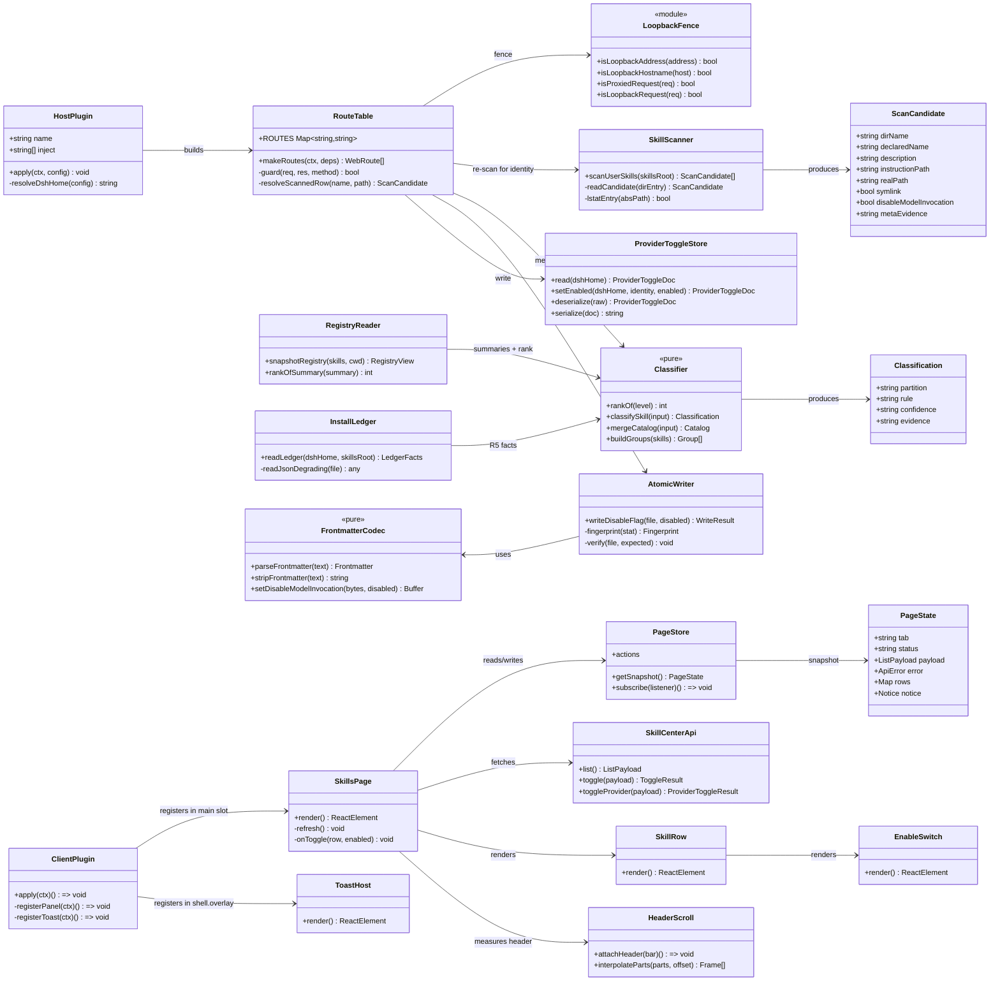

# 类型、判据与纯函数契约

> 类型：规范
> 读者：改 `lib/classify.js`、`lib/scan.js`、`lib/frontmatter.js`、`lib/registry.js` 或要读 payload 的人
> 真源：上述模块的导出签名与 `test/classify.test.mjs`、`test/scan.test.mjs`、`test/frontmatter.test.mjs`
> 更新触发：改 payload 字段、判据阶梯、rank 反推表或 frontmatter 读写规则时，同步改 §3.1 / §3.2
> 规模上限：400

编号 §3.1 / §3.2 保持原值（原件见 `git show a8141eb:docs/system_design.md`）。证据记号 `EX/` `PROF/` `SHELL/` `HIDDER/` 的定义见 `docs/reference/host-plugin-page.md` §1。

---

## 3.1 类型总览（classDiagram）



---

## 3.2 纯函数契约（QA 可直接单测）

> 全部为**无 I/O、无 DOM、无时间依赖**的函数。参数/返回值即断言面。市场面**不参与这里的 9 级阶梯**：装出来的目录靠 R5/R6（台账与 `_meta.json` 的 `source`）命中 `installed`，**不加第 10 级**；市场侧的类型与纯函数见 §3.8。

#### 3.2.1 `lib/names.js`

```js
isSkillName(name: string): boolean
// 真: 'dev-docs-standards' | 'a1'   假: '-a' | 'a-' | 'a--b' | 'A' | '' | 'a b'
// 依据 EX/dsh-skill/lib/index.js 的 SKILL_NAME = /^[a-z0-9]+(?:-[a-z0-9]+)*$/

isWithin(root: string, target: string): boolean     // path.relative 结果不以 '..' 开头且非绝对
identityKey(provider: string, name: string): string // `${provider || ''}#${name}`

isSafeRelativePath(value: string): boolean
// 真: 'SKILL.md' | 'references/a.md' | '.gitignore'    假: '' | '/abs' | '../x' | 'a/../b' | 'a\\b' | 'C:x' | 'a//b' | 段长 >100 | 整体 >240
// 用途：安装清单的唯一路径闸（市场侧，见 §3.8）

isUpstreamIdentity(sourceId: string, owner: string, slug: string): boolean
// 三段同时过 UPSTREAM_SOURCE_ID / UPSTREAM_OWNER / UPSTREAM_SLUG，且都不含 '..'；`market/query.js` 的上游白名单就是这三个常量的别名（一处定义两处消费，别抄第二份）
// 真: ('skillhub','ake','dev-god')    假: ('nope!','a','b') | ('clawhub','../x','y') | (undefined,…)
// Row 的三个**展示**字段（都不进 classifySkill），全由同一个「包根」推导：`originPath` = 宿主 `SkillSummary.resourceBase.path`；`pluginPackage` = 该包 `package.json` 的 `name`（内置块的分组键与标题，`link:` 安装靠它——包不在 node_modules 下时向上最多 6 层找最近的 manifest）；`pluginVersion` = 该包 `package.json.version`、`pluginDescription` = 它的 `description`（截断到 200 字符），两者非空字符串才算数值；`pluginIcon` = 该包 `package.json.icon`（或没有它时的 `exports["./icon"]` 指向的图片文件）读成的 base64 data URL（`lib/plugin-icon.js`，≤256 KiB / svg·png·jpg·jpeg·webp / 不跟随软链 / 不出包根 / 绝不加载模块式导出）。三者失败都是 null。
// `ScanCandidate.upstream` 只由 `_meta.json` 的 source/ownerId/slug 过本判据后给出：`ownerId` 语义因写者而异（我们写 handle，ClawHub CLI 写内部 Convex id，后者当 owner 查 404）⇒ 身份只认我们写的记录，**不从目录名反推**、不按名字 join，也不进任何分区判据（不变式见 routes.md §3.3.1）
```

#### 3.2.2 `lib/classify.js`

```js
/** 分区判定的完整输入（每个字段都有精确来源，见注释） */
/**
 * @typedef {Object} ClassifyInput
 * @property {string}  provider            // R1：summary.provider / 自扫描恒 'filesystem'
 * @property {number}  rank                // R2：1.4.3 反推；自扫描恒 400
 * @property {boolean} symlink             // R4：lstat().isSymbolicLink()
 * @property {boolean} ledgerHit           // R5：台账任一命中
 * @property {boolean} metaSource          // R6：_skillhub_meta.json/_meta.json 有 source
 * @property {boolean} metaRelease         // R7：_meta.json 同时有 ownerId+slug
 * @property {string}  dirName             // R8：目录名
 * @property {string}  declaredName        // R8：frontmatter name
 */
/**
 * @typedef {Object} Classification
 * @property {'builtin'|'local'|'installed'|'excluded'} partition
 * @property {'R1'|'R2'|'R3'|'R4'|'R5'|'R6'|'R7'|'R8'|'R9'} rule   // 命中的那条阶梯（可直接断言）
 * @property {'high'|'medium'} confidence
 * @property {string} evidence        // 只进 tooltip 的文案键，如 'evidence.metaRelease'
 */
classifySkill(input: ClassifyInput): Classification

rankOf(level: string): number       // 1.4.3 表；未知 → 600（不是 Infinity，避免 NaN 比较）
```

判定表（**首个命中即定**，与 `PRD` §3.1.2 逐条对应；`rule` 是给 QA 的断言点）：

| 序 | 条件 | partition | rule |
| --- | --- | --- | --- |
| 1 | `provider !== 'filesystem'` | `builtin` | `R1` |
| 2 | `provider === 'filesystem' && rank === 600` | `builtin` | `R2` |
| 3 | `rank ∈ {100,200,300,500}` | `excluded` | `R3` |
| 4 | `symlink === true` | `local` | `R4` |
| 5 | `ledgerHit` | `installed` | `R5` |
| 6 | `metaSource` | `installed` | `R6` |
| 7 | `metaRelease` | `installed` | `R7` |
| 8 | `dirName` 匹配 `^[a-z0-9][a-z0-9-]*--[a-z0-9][a-z0-9-]*$` 且 `--` 后段 === `declaredName` | `installed`（`confidence:'medium'`） | `R8` |
| 9 | 其余 | `local` | `R9` |

冲突处理（`PRD` §3.1.2 的五条，逐条变成可断言行为）：

| 冲突 | 断言 |
| --- | --- |
| 软链 + 有来源元数据 | `classifySkill({symlink:true, metaRelease:true, …}).partition === 'local'`，`rule === 'R4'` |
| 内置 + 用户根同名 | 由 `mergeCatalog` 的 rank 裁决：bundled(600) 与 user-dsh(400) 同名时 **400 胜**，显示为本地/已安装行；runtime(250) 与 user-dsh(400) 同名时 250 胜，显示为内置行 |
| 「内置判定永远胜出」与「rank 小者胜」互斥 | **以 rank 为准**。理由：G1 的承诺是「面板显示的必须就是模型实际拿到的那一条」；若强制内置胜出，bundled(600) 会盖掉 rank 更小、模型真正拿到的 user-dsh(400) 条目，直接违背 G1。runtime(250) 的存在使两句在多数场景一致，只有 bundled 会冲突。已作为待用户拍板项 Q-B 登记 |
| R5 与 R8 相悖（有前缀但台账记为 local） | `ledgerHit` 在序 5 先命中 ⇒ `installed` |
| 同名只显示一次 | `mergeCatalog` 的 `groups` 内每个 `name` 出现一次 |

#### 3.2.3 `lib/classify.js` 的合并函数

```js
/**
 * @typedef {Object} MergeInput
 * @property {ScanCandidate[]} scanned      // 自扫描（rank 恒 400）
 * @property {RegistrySummary[]} registry   // ctx.skills 快照（已附 rank）
 * @property {LedgerFacts} ledger
 * @property {string} skillsRoot
 * @returns {{groups: Group[], excluded: number, diagnostics: string[]}}
 */
mergeCatalog(input: MergeInput): Catalog
```

不变量（QA 可写成 property test）：

1. 输出的所有 `name` 全局唯一（三分区合起来）。
2. 每条输出的 `rank` 等于输入中同名候选的最小 rank；若并列则来自 `scanned`。
3. `excluded + Σ|groups| === 输入中不同 name 的个数`。
4. 输入含 `PRD` §3.1.3 的五条 fixture 时：`dev-docs-standards → local/R4`、两个 `clawhub-* → installed/R7`、两个 `indiv-* → installed/R8(medium)`。

#### 3.2.4 `lib/frontmatter.js`（字节级）

```js
/** @returns {{ next: Buffer, changed: boolean, inserted: boolean, frontmatter: Frontmatter }} */
setDisableModelInvocation(original: Buffer, disabled: boolean): Rewrite
```

保真清单（每条都是断言）：

| 属性 | 要求 |
| --- | --- |
| BOM（`EF BB BF`） | 有则保留在输出开头，位置不变 |
| 行尾风格 | 逐行保留：CRLF 文件写完仍是 CRLF；混排文件逐行不变 |
| 其它 frontmatter 行 | 字节不变（含空行、缩进、折叠/块标量、注释行） |
| 目标键已存在 | 只替换该行的**值**，保留原前缀空白与行尾注释 |
| 目标键不存在 | 追加为 frontmatter 块内**最后一个顶层键之后**的新行，行尾跟随块内风格 |
| 正文与结尾分隔符之后 | 完全不变（`match[2]` 的原字节切片） |
| 幂等 | `f(f(x,true),true) === f(x,true)`（`changed === false`） |
| 无 frontmatter | 抛 `NO_FRONTMATTER`（路由把它映射成 409 `E_NOT_WRITABLE`，绝不新建块） |

**读侧契约（`parseFrontmatter` / `stripFrontmatter`）**——写入器与解析器解耦：写入器只替换
`disable-model-invocation` 那一行，本节的解析规则只影响**读出什么值**，不影响写回什么字节。

```js
/** @returns {{name?: string, description?: string, displayName?: string, disableModelInvocation: boolean, present: boolean}} */
parseFrontmatter(text: string): Frontmatter
```

| 值类型 | 规则（与宿主 `yaml` 的 `parse` 对齐，宿主即用它读 frontmatter） |
| --- | --- |
| 普通标量 | 去一层引号、去行尾 `#` 注释后 trim（现行为不变）；**`displayName` 顶层 `display-name` 优先，缺失时取 `metadata:` 块内的 `displayName`**（行级、只认缩进键；块内其它键与嵌套块标量正文都跳过；带引号/不带引号都收） |
| 折叠块标量 `>` | 指示符本身**不是值**；正文行之间以**一个空格**连接；`n` 个连续空行折成 `n-1` 个 `\n`（空行成段） |
| 字面块标量 `\|` | 正文行之间保留 `\n`，空行保留为空行 |
| 缩进更深的续行 | 缩进**深于**正文公共缩进的行按字面保留（其换行不被折叠），行内额外缩进原样保留——这是行内列表/代码块不被压平的唯一规则 |
| 公共缩进 | 取正文非空行的最小缩进，逐行剥离；块可以整体更靠右（不要求 2 空格） |
| `-` / `+` / 缺省（chomping） | `-` 去掉末尾换行；缺省(clip) 保留**一个**末尾 `\n`；`+` 保留全部末尾换行 |
| 标量边界 | 正文遇到**非空且不缩进**的行即结束（同级键或闭合 `---`）；指示符后允许行尾 `# 注释` 与可选缩进数字 |
| 空正文（`description: >` 紧跟同级键） | 值为 `''`（因此该条目在扫描层被当作「没有 description」跳过，与宿主 `stringField` 的 `length > 0` 一致） |
| 布尔字段 | 块标量形式同样接受，值按 `true/false/yes/no/on/off/1/0` 判定 |

真机样本：`~/.dsh/skills/clawhub-wpank--ui-design/SKILL.md` 的 `description: >` +
三行缩进正文 → 三句以空格连接、末尾一个 `\n`；修复前该行被读成一个 `>`（QA 报告 KI-2）。

#### 3.2.5 `src/client/model.js` / `header-scroll.js`

```js
rowViewState(row: Row, rows: Map<string,RowRuntime>): 'idle'|'pending'|'failed'
groupEmptyKey(key: 'builtin'|'local'|'installed'): string             // 'group.builtinEmpty' 等
interpolateParts(parts: PartGeometry[], offset: number): Frame[]      // 纯几何插值，无 DOM
```

---

## 3.8 市场类型与归一化纯函数

#### 3.8.1 `MarketItem` / `MarketDetail` / `MarketVersions` / `SourcePage`

```jsonc
// MarketItem —— 市场页唯一的渲染输入，也是去重键的来源
{
  "sourceId": "skillhub",            // 本地算：按上游行的 source 折叠（community/enterprise → skillhub，clawhub → clawhub），跨 scope 恒定
  "id": "skillhub:ake:dev-god",      // 本地算：`${sourceId}:${owner}:${slug}`
  "owner": "ake",                    // 上游；缺失 null
  "slug": "dev-god",                 // 上游；缺失 null
  "displayName": "编程大神.Skill",   // 上游；缺则回落 slug，再缺为空串
  "iconUrl": "https://…png | null",                          // 两种形态，见不变式 6
  "summary": "≤ 400 字符单行",        // 上游；超长截断，缺失为空串
  "author": "阿客实验室",             // 上游；三级回落，全缺 null
  "version": "1.2.4",                // 上游；**缺失如实 null**（镜像缺版本时就是 null）
  "downloads": 11340092,             // 上游；缺失 null（**绝不补 0**）
  "saves": 99, "score": 100000, "tags": ["代码生成", "Bug 修复"],   // 上游 stars/score（缺失 null，绝不补 0）/ subCategories.name 前 3（≤3 条、单条 ≤24 字符、保留大小写、**缺 = []**）
  "updatedAt": 1794205858796,        // 上游；epoch 毫秒，只用于排序，**不上屏**
  "category": "dev-programming",     // 上游；两源都有（U8 起 ClawHub 也有分类）
  "packageKind": "files"             // 本地算：当前两源恒 'files'（'zip' 已于 U7 退役）
}
```

```jsonc
// MarketDetail —— market/detail 的 data
{
  "item": MarketItem,
  "iconUrl": "恒等于 item.iconUrl",            // 路由层复制一份，详情头部直接用；两处永不相同
  "overview": "SKILL.md 正文（≤ 8000 字符）",   // stripFrontmatter 后；正文为空则回落 summary
  "declaredName": "dev-god",                  // parseFrontmatter(SKILL.md).name；不合规也原样给出
  "nameValid": true,                          // isSkillName(declaredName)
  "installTo": "/Users/…/.dsh/skills/dev-god", // nameValid ? join(skillsRoot, declaredName) : skillsRoot
  "files": [{ "path": "SKILL.md", "size": 7953 }], // 清单顺序；sha256 不下发
  "filesComplete": true                        // 'files' 形态恒 true（zip 读不全的 false 分支已于 U7 退役）
}
```

```jsonc
// MarketVersions —— market/versions 的 data（新的在前，不排序、不过滤，保留前 50 条）
{ "source": "skillhub", "owner": "ake", "slug": "dev-god", "namespace": "ake",
  "latest": "1.2.4", "versions": [{ "version": "1.2.4", "publishedAt": 1762396800000 }], "total": 3 }
```

`SourcePage`（`list` / `search` 的返回）= `{items: MarketItem[], next: string|null, total: number|null}`：`next` 由 `encodeCursor` 产出、客户端原样回传（`null` = 没有下一页），`total` 只有 SkillHub 给。

「缺 = null」不变式（逐条可断言）：

1. 每个字段都存在，不出现 `undefined`；上游没给的一律 `null`，`downloads`、`saves`、`score` 不补 `0`、`version` 不补 `'latest'`、`category` 不补 `''`、**`tags` 是 `[]` 不是 `null`**。
2. `id` 全仓库唯一；同一 `id` 出现两次时保留第一次出现的那条（浏览器侧 `mergeBatches` 负责）；`installTo` 在 `nameValid === false` 时等于 `skillsRoot` 本身（不吃掉最后一级目录名），界面据此显示「不能安装」。`overview` 不含 frontmatter 分隔行与 `name:`/`description:` 头字段。
3. 卡片与详情**不显示任何时间**：`updatedAt` 只影响顺序。**唯一例外**：已安装详情的版本展开列表显示 `publishedAt`（上游 `createdAt`，格式化成 `YYYY-MM-DD`）——不同字段、不同页面，登记在 `docs/contracts/decisions.md` 附录 R-1。
4. `iconUrl` 只有两种合法形态：① 绝对 `https:`（可解析即接受，**不做 host/path 白名单**——两个图床都是逐技能真图）；② `null`。`http:`、相对路径、空值与非字符串归 `null`；`null` 与**加载失败**都是「回落首字母头像」，破图由浏览器侧 `onError` 兜住。`lucide:FileText` 与 `/api/v1/skill-icons/<64hex>` 两种旧形态随 `clawhub.ai` 与两条代理路由于 U7 退场。

#### 3.8.2 `lib/market/normalize.js` 与 `mergeBatches` 的纯函数契约

```js
// lib/market/normalize.js —— 无 I/O、无时钟
textOrNull(value): string|null / numberOrNull(value): number|null / finiteOrNull(value): number|null / timestampOrNull(value): number|null / mirrorOwnerOf(raw): string|null   // 空串与不可解析 → null；numberOrNull 取整、finiteOrNull 不截断（score 是连续分）；mirrorOwnerOf 取原生 ClawHub owner（upstream_owner_login → 剥 clawhub_ → null）
clampLine(value, max) / clampBlock(value, max): string / tagListOf(value): string[]   // 单行折叠 / 保留换行，超长截断 / 标签：≤3 条、取 subCategories[].name、去重、保留大小写
marketId(sourceId, owner, slug): string    // `${sourceId}:${owner ?? ''}:${slug ?? ''}`
marketItem(fields): MarketItem              // 字段补齐（上表）
fromSkillhubListItem(raw, packageKind?): MarketItem|null / fromMirrorRow(raw): MarketItem|null   // 后者按 raw.source 折叠身份（两个适配器共用）
fromSkillhubDetail(raw, packageKind?): MarketItem|null
fromClawhubMirrorItem(raw, packageKind?): MarketItem|null   // 镜像条目：复用 fromSkillhubListItem 的字段读取，owner 取 upstream_owner_login，id 重拼，version 过 versionLike
fromClawhubMirrorDetail(raw, owner): MarketItem|null        // 镜像详情：字段同 SkillHub，身份用调用方解析出的原生 owner（detail() 用）
overviewOf(sourceText, fallback?): string   // stripFrontmatter → 正文；空则回落 fallback
declaredNameOf(sourceText): string / nameIsValid(name): boolean   // 声明名，及其是否合文法
sortByUpdatedDesc(items): MarketItem[]      // 新的降序数组；null 时间排最后，相等时保持原序
```

契约要点：

1. **同一个上游响应重复喂进去，输出必须逐字段相同**（无随机、无时钟、无缓存）。
2. `fromSkillhubListItem` 的 `owner` 取自 `namespace.handle`；缺失时 `owner = null` 且该条不可安装（不猜、不补）。`summary` 超 400 字符时截断并以 ASCII `...` 结尾。
3. `fromClawhubMirrorItem` **认不出身份就返回 `null`**（`upstream_owner_login` 缺且 `namespace.handle` 不是 `clawhub_<owner>`、或 `slug` 为空）：装不上的卡片不如不出现；`version` 过 `versionLike()`，像 id 的串一律 `null`。

```js
// src/client/market-model.js —— 合并只在这里发生，纯函数、node 可直测
marketKeyOf(item): string   // item.id，缺则 `${sourceId}:${owner}:${slug}`
metaSegments(item) / authorTextOf(item) / statSegments(item) / ratingOf(item) / ratingTextOf(rating)   // 作者行的段（@owner/slug + 版本）／handle 三级回落／三格数字槽（**顺序 评分·下载·收藏**）／score 折 4.0–5.0／一位小数字符串
mergeBatches(pages: {sourceId: string, items: MarketItem[]}[], options?: {existing?: MarketItem[]}): MarketItem[]
```

`mergeBatches` 的语义（每条都是断言）：**不交错、不排序**（2026-11-09 队长裁决取消 1:1 交错与「让位」）。

- `existing` 原样保留在前；新一页的条目按 `pages` 给的**来源顺序整段拼接**（先第一个源那一页的全部，再第二个源的），已有项的相对顺序永不被打乱。**函数不排序**：`updated` 的页内顺序由适配器负责（`sortByUpdatedDesc`），跨源不重排。
- 去重按 `marketKeyOf`：同一个 key 第二次出现即丢弃，**保留第一次出现的条目**；短页照收（n < limit 就只追加 n 条），「还有没有下一页」只看 `next === null`、不看本页条数；输入为空时返回 `existing` 的副本，函数不修改任何入参。

---

## 验收

用例编号即验收：K1–K5（判据阶梯 / rank / 同名裁决，`test/classify.test.mjs`）、K7–K10（frontmatter 保真，`test/frontmatter.test.mjs`）、K11–K12（扫描，`test/scan.test.mjs`）、K26（计数文案取自同一份 payload，`test/model.test.mjs`）。
