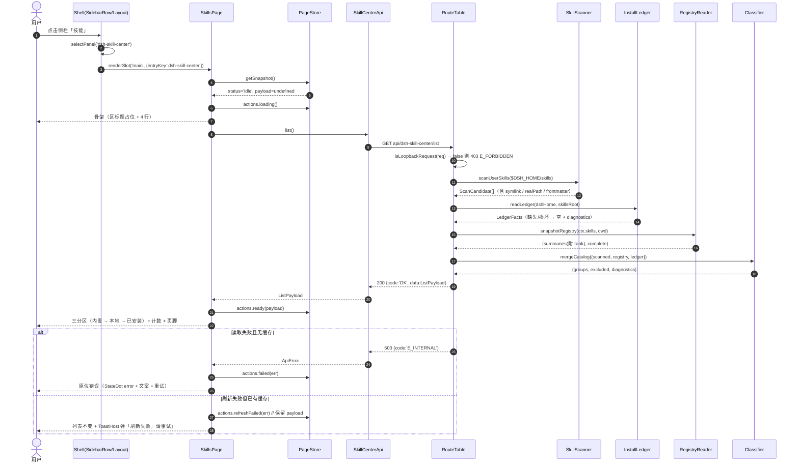
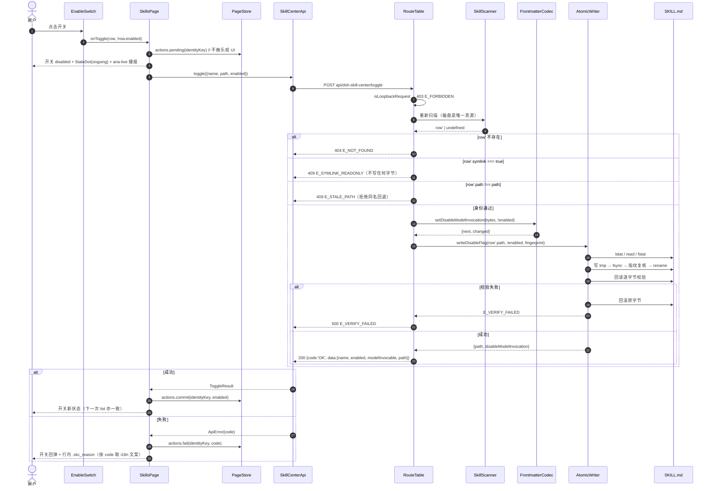
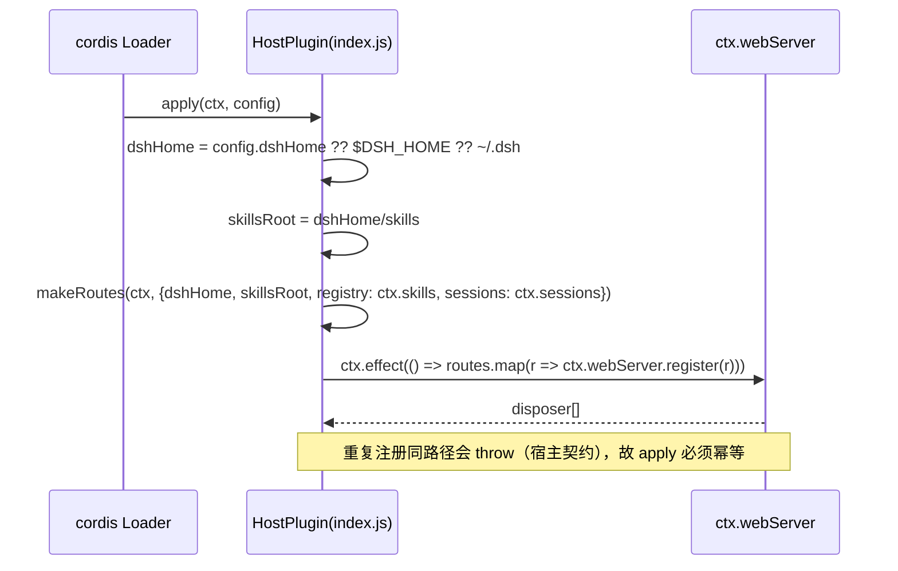

# 调用流程与未定事项

> 类型：规范
> 读者：要跟一次「打开面板 / 点开关 / 启动初始化」的完整路径，或要判断哪些行为还没定的人
> 真源：`lib/routes.js` + `lib/scan.js` + `src/client/state.js` 的实际调用顺序
> 更新触发：改调用顺序、缓存策略、初始化时机，或某个未定事项有了结论时，同步改 §4 / §5
> 规模上限：400

编号 §4 / §5 保持原值（原件见 `git show a8141eb:docs/system_design.md`）。

---

## 4 调用流程

### 4.1 打开/刷新（list）

### 4.2 开关（本地/已安装真目录 + 软链拒绝分支）

### 4.3 内置技能（provider 开关）与软链行的差异

- **内置行**：`POST provider-toggle` → 归一化 `(provider,name)` → 重新 `mergeCatalog` 断言该身份仍是 `partition:'builtin'` 且 `readonlyReason:'provider-store'` → 写自有存储 → 返回 `{disabled}`。**没有路径可校验，也没有文件被碰**。
- **软链行**：客户端**根本不发请求**（`row.writable === false` ⇒ 不渲染 `EnableSwitch`，渲染 `ReadonlyTag`）；服务端仍保留拒绝（双保险），错误码 `E_SYMLINK_READONLY`，前端文案 `error.E_SYMLINK_READONLY`。

### 4.4 初始化（Host 半部）

单实例守卫：`apply` 里若检测到同名路由已存在（重复加载同一包），第二次注册会抛错并打断启动 —— 因此 `index.js` 用一个模块级 `let applied = false` 做幂等（`PROF/@linxin666/dsh-client-ui-skill-explorer/lib/index.js` 的 `mountOnce(...)` 是同一目的的更完整实现，我们只需要最简单的形态）。

---

---

## 5 待明确事项

> 详细取舍与验证方法见文末「待明确 / 假设」。这里只列**影响实现顺序**的三项。

| # | 事项 | 本轮采用 | 影响 |
| --- | --- | --- | --- |
| D1 | `SkillSummary` 不暴露 `rank` | 用 `source`/`provider` 反推（1.4.3），第三方 provider 一律按 600 | 只有当某个 provider 自报 rank ≠ 600 时，同名裁决可能与模型实际拿到的不一致；验证方法见文末 A1/A2 |
| D2 | PRD 两句「rank 小者胜」与「内置永远胜出」在 bundled(600) vs user(400) 时互斥 | 取 **rank 小者胜**（保 G1 的核心承诺：面板显示的必须是模型拿到的那条） | 若用户坚持「内置永远显示为内置」，需要在 `mergeCatalog` 里加一条覆盖规则，改动 1 个函数 |
| D3 | 页头停靠用「克隆量测 + 插值」在真机上是否稳定 | 照 port 宿主实现 | 若抖动，降级阶梯：① 去掉逐部件插值，只保留 sticky + `data-compact` 的 padding/分隔线切换；② 再不行退回纯 `position:sticky` + 静态 28px。每一级都要在真机对着宿主插件页比对后再决定 |

---

---

## 验收

`test/api.test.mjs`（请求形状）、`test/routes.test.mjs`（真实落盘到临时目录）、`test/state.test.mjs`（pending → commit / fail）、`test/index.test.mjs`（初始化与 `ctx.effect` 释放）。
