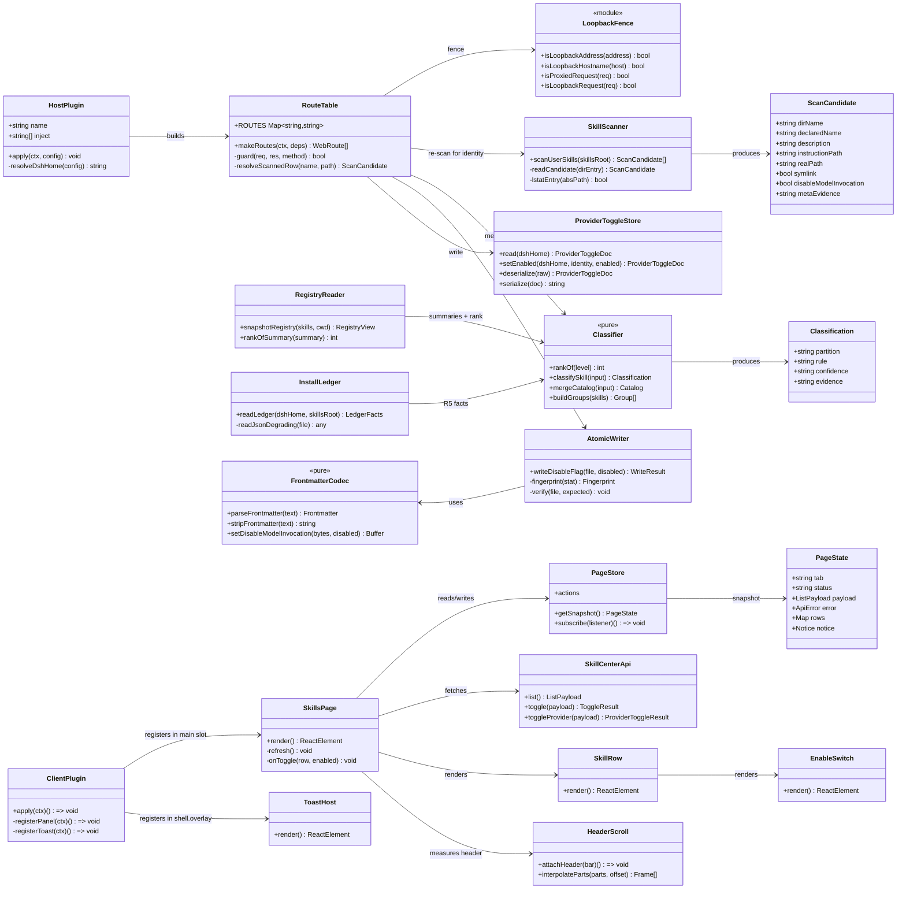
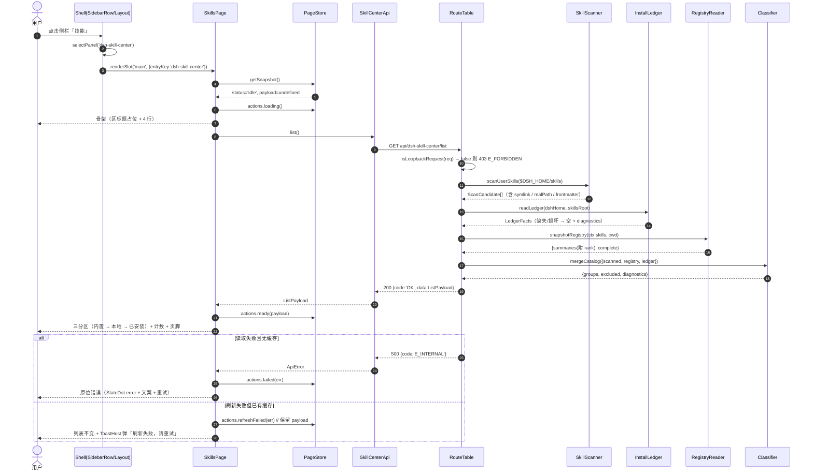
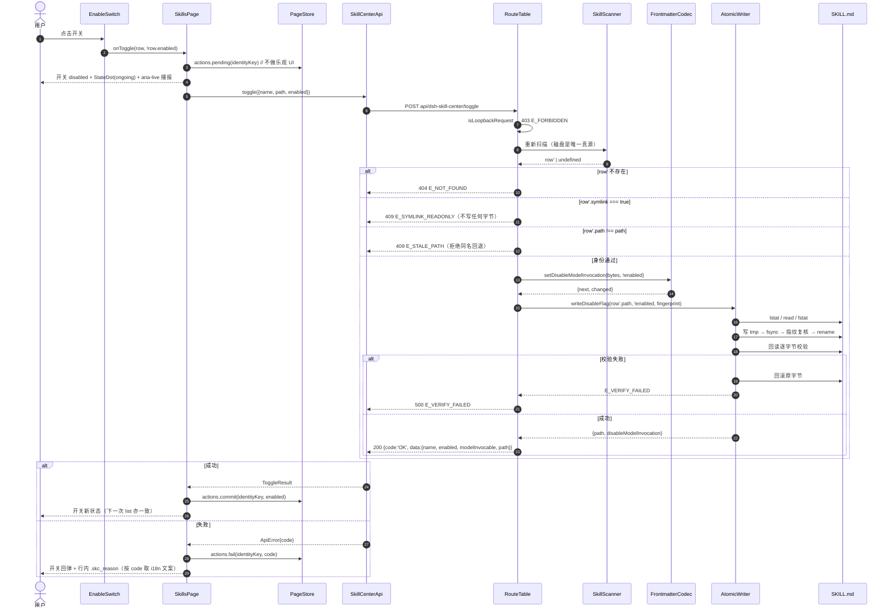
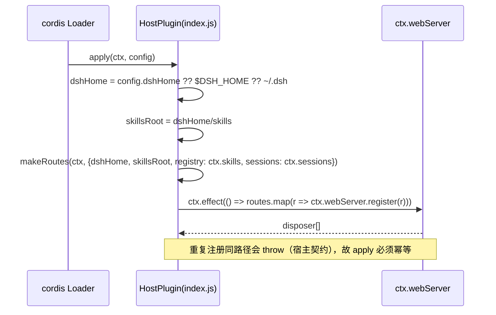
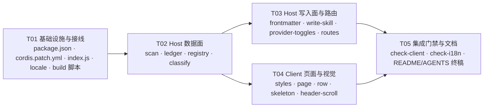

# dsh-skill-center 系统设计

模式：系统设计（架构师 · 高见远）｜Language：中文（简体）
上游输入：`docs/PRD.md`（388 行，task-1）+ 队长补充决策（2026-11-08，两条，覆盖 PRD 对应条款）
本文不含业务实现代码；可出现签名、类型、契约与 ≤10 行伪代码。

**证据记号**（本文所有「依据」列的缩写，全部为本机真实产物）：

| 记号 | 实际路径 | 说明 |
| --- | --- | --- |
| `EX/` | `/Applications/DeepSeek Harness.app/Contents/Resources/app.asar` 内的 `dsh/node_modules/@deepseek-ai/` | asar 是「头部 JSON + 拼接内容」，不是目录：`u32@4 = headerSize`、`u32@12 = jsonLen`、JSON 从 byte 16 起、内容区 = `8 + headerSize` |
| `SHELL/` | `EX/dsh-web-frontend/dist/assets`（`index-BgUyXZcc.js`、`index-lh_YM6sT.css`） | 前端 shell 产物，单行压缩，按唯一字串 grep |
| `PROF/` | `~/.dsh/profiles/desktop/node_modules/` | 本机已装插件 |
| `HIDDER/` | `~/Documents/Agents/Plugins/dsh-hidder/` | 用户自己的插件；`docs/reference/host-selectors.md`、`docs/reference/settings-ui.md`、`spec.md` 有宿主真实取值 |
| `PRD` | `docs/PRD.md` | 上游产品规格 |

> 宿主版本：`0.2.2-rc.1`（`HIDDER/docs/reference/host-selectors.md` 头部的双证采集记录）。本文所有宿主读数采集于 2026-11-08，同一版本。

---

## 1 实现方案与框架选型

### 1.1 核心难点 → 方案 → 模式

| # | 难点 | 方案 | 依据 |
| --- | --- | --- | --- |
| 1 | 页面必须「与宿主插件页 1:1」，但宿主样式类名是每次构建变化的 module hash（`w6M7KW_*`、`_tabs_1lga9_1`、`_switch_1ik0f_5`） | 三条路分开走：**能拿到组件就用宿主的 primitives 组件**（SegmentedTabs / Switch / Button / Tooltip / Toast / StateDot / 图标）；**拿不到组件就把规则体逐字转写**成自有前缀 `skc_` 的类；**绝不 write 第二套样式系统**（不引 Tailwind/MUI/antd） | `HIDDER/docs/reference/settings-ui.md` §9「Host class names are build-hashed; none may appear in your selectors」；`EX/dsh-client-ui-plugin-manager/lib/client.js` 内 `PluginManagerPage.module.css` 的 `css` 字符串（下称 **[PM-CSS]**）；`PRD` §1 硬约束 |
| 2 | 侧栏入口要打开**全局页**（不属于任何会话），而不是设置页/抽屉 | 用 shell 自己的两座位：`sidebar.panellist`（行）+ `main`（keyed 页面）。shell 会接管行盒子、标签、选中高亮、折叠轨、页面切换 | `EX/dsh-client-ui-plugin-manager/lib/client.js` 的 `slots.inject("sidebar.panellist", …)` 与 `slots.inject("main", …)`（`PANEL_ID = "plugins"`）；`EX/dsh-client-ui-layout/README.md`「Global panels occupy the root-scoped `main` keyed slot … `ctx.layout.selectPanel(id)`」 |
| 3 | 「打开任意会话即回到会话正文」 | **不需要我们实现**：workspace 打开会话走 `openSession → replaceMain(…, "reveal")` → `ctx.layout.selectPanel(null)` | `PROF` 外的宿主包 `EX/dsh-client-ui-workspace/lib/client.js`（`openSession(target)` / `replaceMain` 内 `if (panel === "reveal") this.ctx.layout.selectPanel(null)`） |
| 4 | 分区判据必须可单测、可复现 | 判定与合并全部收敛成**纯函数**（`classify.js`：`rankOf` / `classifySkill` / `mergeCatalog`），I/O 全部在边界模块 | `PRD` §3.1.2、§3.5（A1/A2 可直接喂 fixture） |
| 5 | frontmatter 改写必须**逐字节保真**，且本机真的存在 CRLF 技能文件 | 自写字节级改写器（保留 BOM、保留每行原行尾），不复用现成实现 | 本机实测：`~/.dsh/skills/indiv-guipi--find-skills/SKILL.md` 首字节为 `---\r\n`（CRLF），其余 4 条为 LF。`PROF/@linxin666/dsh-client-ui-skill-explorer/lib/index.js` 的 `setFrontmatterField` 用 `` `---\n${next.join("\n")}\n---${match[2]}` `` **会把 CRLF 与 BOM 一起洗掉**，因此不可移植 |
| 6 | 写入要能判定「拒绝过期同名回退」 | 写路由**不接受信任的路径**：先按 name 重新扫描，再要求 `resolved.path === submitted.path`，不等即 409 | `PROF/@linxin666/dsh-client-ui-skill-explorer/lib/index.js` 的 `resolveScannedSkill`（同一模式，含 404/409 语义） |
| 7 | 软链技能只读（队长决策 2） | 三层同时拦：扫描层给 `symlink` 事实 → 展示层渲染静态标记不渲染开关 → **写路由拒绝并发错误码** | 队长消息（2026-11-08）；`PRD` §3.1.1 R4（`lstat().isSymbolicLink()`，不是 `stat`） |

架构模式：**分层 + 两半（dual-face）**。Host 半部 = 纯数据面（扫描/判定/写入/路由，零 React）；Client 半部 = 纯展示面（React 组件 + 一个模块级 store），二者只通过 `/api/dsh-skill-center/*` 的 JSON 契约耦合。

### 1.2 包形态与接线

#### 1.2.1 两半如何拆分与导出

一个包、两半、四个导出点：

```jsonc
// package.json（节选；完整形态见附录 C）
{
  "name": "dsh-skill-center",
  "type": "module",
  "main": "index.js",                       // Host 半部入口（ESM，无构建）
  "exports": {
    ".": "./index.js",
    "./client": "./client.js",              // 必须是字符串或 {default:string}
    "./package.json": "./package.json",
    "./locale/*.json": "./locale/*.json"
  },
  "dsh": {
    "manifestVersion": 1,
    "bundle": { "patch": "./cordis.patch.yml" },
    "client": {
      "platform": "web",
      "immediately": true,
      "inject": [
        "@deepseek-ai/dsh-client-locale",
        "@deepseek-ai/dsh-client-ui-layout",
        "@deepseek-ai/dsh-client-ui-sidebar"
      ]
    }
  }
}
```

依据与约束：

- **`exports["./client"]` 是硬契约**：宿主按 `clientExportOf(pkgName, pkg.exports)` 取它，缺失即 `client-modules: <pkg> declares dsh.client but exports no "./client" bundle`（`EX/dsh-client-modules/lib/index.js`）。只接受字符串，或 `{ default: string }`；不接受 `{import, require}` 之外的嵌套形态。
- **`dsh.client` 的合法字段**只有四个：`platform`（必填字符串）、`inject`（字符串数组）、`external`（字符串数组）、`immediately`（布尔）。多写/类型错会在扫描时抛错（`parseDshClient`，`EX/dsh-client-modules/lib/index.js`）。
- `immediately: true` 的语义是**启动时预取该 bundle**（`SHELL/index-BgUyXZcc.js` 的 `prefetchImmediateTier()`：`manifest.plugins.filter(e => e.immediately).map(e => this.modules.prefetch(e.id))`），不是「立即 apply」。我们取 `true`，与 `PROF/dsh-hidder/package.json`、`PROF/@montersy123/dsh-skill-market/package.json` 一致（首屏侧栏行不等一个网络瀑布）。
- `inject` 只影响 **bundle 加载顺序**（boot graph 让被请求者排在消费者之前，`EX/dsh-client-modules/lib/index.js` 的 `graphRow`/排序注释）。真正的座位等待由 `ctx.slots.inject(...)` 完成（见 1.2.3），所以 `inject` 写少了也不会崩，写多了只是多拉几个已在图里的包。这里只列我们真正依赖的三个。
- **Host 半部不需要 `dsh.client`，Client 半部不需要 `main`**：`main`/`exports["."]` 给 Host（cordis 加载 ESM 插件），`exports["./client"]` 给浏览器。

#### 1.2.2 `cordis.patch.yml` 需要哪些行

只有一行 plugin 条目：**bundle 层要能把这个包选成 profile bundle，就必须有一条 Host 行**（Host 行本身可以什么都不注册）。

```yaml
# bundle layer for dsh-skill-center —— 本插件的 Host 半部负责 /api/dsh-skill-center/* 路由，
# Client 半部负责侧栏「技能」行与主区全局页。这一条只是让包可被 profile 选中。
- insert:
    - id: dsh-skill-center
      name: dsh-skill-center
```

依据：`PROF/dsh-hidder/cordis.patch.yml`（单行 `insert`）、`PROF/@linxin666/dsh-client-ui-skill-explorer/cordis.patch.yml`、`PROF/@michengai/dsh-skills-manager/cordis.patch.yml`、`PROF/@montersy123/dsh-skill-market/cordis.patch.yml` —— 四份文件都是「一个 `insert` 一个 id/name」的形状。

**部署侧（不属于包内容，装的时候才做）**：`~/.dsh/profiles/desktop/package.json` 加 `"dsh-skill-center": "link:../../Documents/Agents/Plugins/dsh-skill-center"`、`dsh.profile.bundles` 插入 `"dsh-skill-center"`、`node_modules` 建相对软链。bundle 列表**只在启动时读**，改完必须重启 DSH（项目记忆「DSH 插件开发」条已记录同一坑）。

#### 1.2.3 侧栏入口 + 全局页的注册方式（与宿主「插件」页同构）

按宿主 `ui-plugin-manager` 的两条语句**逐句对齐**（`EX/dsh-client-ui-plugin-manager/lib/client.js`）：

```js
// ① 侧栏行：shell 拥有按钮、标签、tooltip、rail 几何；我们只画图标
ctx.slots.inject('sidebar.panellist', () => ctx.slots.register({
  name: 'sidebar.panellist',
  id: PANEL_ID,              // 'dsh-skill-center'
  order: PANEL_ORDER,        // 40
  label: () => tt('panel.label'),   // 单一 i18n 键；请勿硬编码中文
}, PanelIcon));

// ② 主区全局页：keyed slot，key 与行的 id 必须相同
ctx.slots.inject('main', () => ctx.slots.register({
  name: 'main',
  key: PANEL_ID,
  locale: NS,                // 让页面组件拿到 t（宿主同款）
  inject: () => ({ store, api }),
}, SkillsPage));
```

为什么这样就能满足 P0-1「不是会话页」：

| 需求 | 机制 | 证据 |
| --- | --- | --- |
| 行出现在侧栏 | `sidebar.panellist` 是 list slot，`panels` 默认全部显示（`unpinned` 初值为空） | `EX/dsh-client-ui-sidebar/lib/client.js`：`panels.filter(({id}) => id === "plugins" \|\| !unpinned.includes(id))`；`createPanelPins` 的 `unpinned: NO_PANELS` |
| 点击行切到页面 | 行 `onClick` → `selectPanel(id)` → `ctx.layout.selectPanel(id)` | 同上 `PanelRow` 的 `onClick`；`EX/dsh-client-ui-layout/lib/client.js` 的 `LayoutController.selectPanel` |
| 页面占主区 | `main` 是 `kind:"keyed", scope:"root"`；`renderSlot("main", {}, { entryKey: panelId ?? "conversation" })` | `EX/dsh-client-ui-layout/lib/client.js` 的 `MainPanel` 与 root 槽声明 |
| 打开会话回正文 | `openSession → replaceMain(…,"reveal") → ctx.layout.selectPanel(null)` | `EX/dsh-client-ui-workspace/lib/client.js` |
| 面板被移除时不留死状态 | `retainMainPanels` 在 `main` 注册表变化时把失效的 `activePanelId` 归零 | `EX/dsh-client-ui-layout/lib/client.js` |
| 标签由 shell 解析 | `label: resolveSlotLabel(options.label) ?? id`，并在 `slots.subscribe("sidebar.panellist")` 与 `locale.subscribe` 时重算 | `EX/dsh-client-ui-sidebar/lib/client.js`（`syncPanels`）/ `HIDDER/docs/reference/host-selectors.md` §1 |

`PANEL_ORDER = 40`：本机已有 `plugins`(0)、`dsh-market`(1)、`schedules`(10)、`dsh-context`(20)、`mnemon`(30)，40 不撞号且排在已知行之后；要改位置只改这一个常量（`HIDDER/docs/reference/host-selectors.md` §1 列出该 profile 的已知 order）。

图标组件签名：`({ size, active }) => ReactElement`（shell 传 `size: wide ? 16 : 18`）。我们用 primitives 的 `IconSkillOutlineRegular`（图标组件清单见 §1.5.3）。

#### 1.2.4 Bundle 运行时 `require` 能拿到什么（决定「不许 import 任意包」）

浏览器端 `factory(require)` 的解析顺序是：**平台 seed → 其它插件的 client 模块（`dsh.client` 图）→ 抛错**（`EX/dsh-client-modules/lib/client.js` 的 `import(specifier)`：先 `this.seed.has(specifier)`，再 `graphRows`）。平台 seed 的键是固定 11 个：

```
react, react/jsx-runtime, react-dom, react-dom/client, @deepseek-ai/cordis, zod,
@tanstack/react-virtual, @deepseek-ai/dsh-client-store,
@deepseek-ai/dsh-client-ui-slots, @deepseek-ai/dsh-client-ui-primitives,
@deepseek-ai/dsh-client-ui-dockkit
```

依据：`SHELL/index-BgUyXZcc.js` 里 `function YZ(){return{react:…,"react/jsx-runtime":…,…,"@deepseek-ai/dsh-client-ui-dockkit":…}}`（宿主传给 `__ModuleLoader__.create` 的 seed map）。

因此：**客户端代码只允许 `require` 上面 11 个**（我们实际用 `react`、`react/jsx-runtime`、`@deepseek-ai/dsh-client-ui-primitives`），其它一律走 `ctx.*` 服务或 `fetch` 自己的路由。

#### 1.2.5 接线相关的硬事实（不照做就会白屏）

1. client bundle 必须自己调用 `window.__ModuleLoader__.load({ id, factory })`，且 `id` 与包名一致；否则宿主报 `bundle … loaded without registering "<id>" via __ModuleLoader__.load`（`EX/dsh-client-modules/lib/client.js`）。`PROF/dsh-hidder/client.js:37`、`PROF/@michengai/dsh-skills-manager/lib/client.js:1`、`EX/dsh-client-ui-plugin-manager/lib/client.js:1` 三处都是这个形状。
2. 样式**自己注入**为 `<style data-plugin-css="dsh-skill-center/client.css">`，并按同一选择器去重（宿主同款：`PluginManagerPage.module.css` 的 loader 用 `tag.dataset.pluginCss = tagId`）。`HIDDER/docs/reference/settings-ui.md` §9 把 `style[data-plugin-css=…]` 列为可健康检查的稳定钩子。
3. 路由 URL 必须**文档相对**（`api/dsh-skill-center/list`，没有前导 `/`）：GUI 用 `<base href="./">`，子路径部署下根绝对路径会逃出前缀。`PROF/@linxin666/dsh-client-ui-skill-explorer/lib/types/client/api.d.ts` 的注释 + 其 `lib/client.js` 的 `API` 常量就是这套写法（issue #1707 的现场记录）。

### 1.3 构建方式：**明确决定 —— esbuild 打单一 client bundle，源码按模块拆分，产物入库**

| | 方案 A 零构建手写单文件 | 方案 B（**选定**）esbuild + 模块化源码 |
| --- | --- | --- |
| 可维护性 | `PROF/dsh-hidder/client.js` 已 259 KB / 约 6000 行，其 `AGENTS.md` 明文写「不要整文件重写…一次改动不该让 diff 变成整个文件」——这就是单文件的代价 | 10 个源文件，每个 ≤ 300 行，改一个函数只 diff 一个文件 |
| 可测试性 | 纯函数被关在 `window.__ModuleLoader__` 的 factory 闭包里，node 无法 import；测它只能造假 `window`（hidder 的 `test/smoke.mjs` 就是这条路，168 条用例全跑在假 DOM 上，其 `AGENTS.md` 明确记录「证明不了那个选择器选中的是对的」） | 纯函数放在**普通 ESM 文件**里，`node --test` 直接 import，无需浏览器、无需构建 |
| 「1:1」风险 | JSX 手写成 `createElement`，易错 | JSX 交给 esbuild，组件树与宿主同形 |

**决定**：

- 源码：`src/client/*.jsx|*.js`，**普通 ESM**，纯逻辑模块（`model.js`、`header-scroll.js` 的纯函数部分）**不含 JSX**，可被 node 直接 import。
- 产物：`client.js`（仓库根）—— `scripts/build-client.mjs` 用 esbuild 打成 **CJS 单文件**，再套上 `__ModuleLoader__.load` 外壳；**产物入库**（本插件靠 `link:` 安装，没有 install 步骤，不提交产物就没有可用的浏览器半部）。
- 版本锁定与守卫：`esbuild@0.25.0`（与 `PROF/@michengai/dsh-skills-manager` 的 devDependency 同版本），并在 `scripts/check-client.mjs` 里做「重打一次 → 与已提交产物逐字节比对」，防止「改了源码忘了 build」。
- 若 `npm install` 不可用（离线）：已提交的 `client.js` 仍可运行；`npm run build` 会失败并明确报错，不会静默产出半成品。

`scripts/build-client.mjs` 的关键参数（照抄即可）：

```js
const result = await esbuild.build({
  entryPoints: ['src/client/index.jsx'],
  bundle: true, format: 'cjs', platform: 'browser', target: 'es2022',
  jsx: 'automatic',
  external: ['react', 'react/jsx-runtime', 'react-dom', 'react-dom/client',
             '@deepseek-ai/*', 'zod', '@tanstack/react-virtual'],
  loader: { '.json': 'json' },   // locale/*.json 内联进 bundle
  minify: false,                 // 保持可读：报错栈要能落回源码行
  write: false,
});
// 外壳：window.__ModuleLoader__.load({ id: '@…/dsh-skill-center', factory: (require) => { … } })
```

为什么 `external` 用通配 `@deepseek-ai/*` 而不是逐个列：seed 与 graph 的解析在运行时完成，打包期把它们留在 `require(...)` 里就是唯一正确做法；漏列一个会让 esbuild 试图内联宿主的私有实现。

### 1.4 数据源与合并

#### 1.4.1 两个数据源，各管一段事实

| 源 | 提供什么 | 谁提供 | 依据 |
| --- | --- | --- | --- |
| **A. 自扫描** `$DSH_HOME/skills` | 目录条目、**是否软链**、realpath、`SKILL.md` 的 `name`/`description`/`disable-model-invocation`、`_meta.json` / `_skillhub_meta.json` | 我们自己 `lib/scan.js` | `PRD` §3.1.1 R3/R4/R6/R7/R9；本机 5 条实测（`PRD` §3.1.3） |
| **B. `ctx.skills` 注册表** | `{name, path?, description, whenToUse?, invocation, source, provider, resourceBase?}`，以及 bundled / runtime / provider 条目 | `ctx.skills.snapshot({cwd})` | `EX/dsh-skill/lib/index.js` 的 `toSummary()`（字段就是这 8 个）；README「A consumer asks for the current catalog of a workspace and receives every winning skill summary」 |

关键事实：**`SkillSummary` 不暴露 `rank`**（`toSummary` 只搬 `source`/`provider`），所以 rank 必须由 `source`/`provider` 反推（见 1.4.3）。这是本设计的**已知近似**，写进 §5。

另一个关键事实：本 profile 的 `@deepseek-ai/dsh-base` bundle 在 **profile 层**挂了 `dsh-skill` + `dsh-skill-filesystem` + `dsh-tool-skill`（`EX/dsh-base/cordis.patch.yml`），所以 Host 半部的 `ctx.skills` **能看到** user-dsh 条目。但我们**仍然自己扫** `~/.dsh/skills`，因为注册表不告诉你「这条是不是软链」（R4），也不给你 `_meta.json`。注册表在我们这里只负责三件事：bundled/runtime/其它 provider 条目、项目级与 `user-agents` 条目的**计数**、以及同名裁决时的 rank 参照。

#### 1.4.2 合并与 9 级判定

```
scan($DSH_HOME/skills) ──┐
                          ├─► mergeCatalog() ─► groups{builtin,local,installed} + excludedCount + diagnostics
registry.snapshot(cwd) ──┘        ▲
ledger.readAll() ─────────────────┘   （R5：台账只影响判定，不影响去重）
```

合并规则（**先裁决、后分类**，这是唯一自洽的顺序）：

1. 两组候选都带 `rank`（自扫描恒 400）。
2. 按 `name` 分组；组内取 `rank` 最小者；**同 rank 时自扫描条目优先**（它带软链/路径事实，且可写）。
3. 对**胜者**跑 9 级判定（§3.2 的 `classifySkill`）。
4. 判定为 `excluded` 的胜者**不进三分区**，但计入 `excludedCount`（页脚「另有 N 个…」）。
5. 分区内按 `name` 码点排序（`compareCodePoints`，与注册表一致：`EX/dsh-skill/lib/index.js`）。

为什么必须先裁决：`PRD` §3.1.2「同名跨分区：不重复展示，按官方 rank 数值小者胜，面板显示的必须就是模型实际拿到的那一条」。若先分类再去重，会出现「一条被 rank 更高的同名技能遮蔽，却仍然显示成另一个分区」的自相矛盾。

性能（对 `PRD` G3 的 P95 ≤ 800ms）：

- 每次 `list` 都做一次**新鲜扫描**（`readdir` + 每个条目一次 `SKILL.md` 读取 + 一次 `lstat`）。本机 5 条样本的量级是「十几次 `fs` 调用」，不需要缓存；缓存反而会让「手改了文件」变成看得见的过期数据。
- 唯一可能慢的是 `ctx.skills.snapshot({cwd})`（要等 provider 的 `list()`）。它 `complete: false` 时我们仍返回已收集项（`complete` 透给客户端），不阻塞首屏。
- 客户端只发**一个**请求；骨架在请求前就已上屏，因此首屏可交互时间与扫描耗时解耦（≤ 1 帧）。

#### 1.4.3 rank 反推表（`SkillSummary` 无 rank 的补偿）

| `summary.source` | rank | 依据 |
| --- | --- | --- |
| `project-dsh` | 100 | `EX/dsh-skill-filesystem/README.md`「Roots and priority」表 |
| `project-agents` | 200 | 同上 |
| `custom` | 300 | 同上 |
| `user-dsh` | 400 | 同上 |
| `user-agents` | 500 | 同上 |
| `bundled` | 600 | 同上（`bundledSkillDir` 配置时为 600）；`EX/dsh-skill/lib/index.js` 的 `BUNDLED_SKILL_RANK = 600` |
| *（`source` 缺失且 `provider === 'runtime'`）* | 250 | `EX/dsh-skill/lib/index.js` 的 `RUNTIME_RANK = 250`、`RUNTIME_PROVIDER = "runtime"`；`validateRuntimeSkill` **不校验 `source`**，所以 runtime 条目的 `source` 可能是 `undefined` |
| 其它（第三方 provider 自注册） | 600 | `BUNDLED_SKILL_RANK` 的注释：「Standard precedence rank for packaged skill providers and local bundled roots」；`ctx.skills.registerProvider` 的候选要自带 `rank`，约定值就是它 |

`PROF/@linxin666/dsh-client-ui-skill-explorer/lib/index.js` 的 `SKILL_SOURCE_RANK` 与我们这张表逐项相同（含 `runtime: 250`），可作为交叉验证。

### 1.5 视觉实现策略（1:1 的可行路径）

#### 1.5.1 三类元素，三种落地方式

| 类别 | 元素 | 做法 | 理由 |
| --- | --- | --- | --- |
| **A. 直接使用宿主组件** | 页签 `SegmentedTabs`、行内 `Switch`、`Button`、`Tooltip`、`Toast`、`StateDot`、全部图标 | `require('@deepseek-ai/dsh-client-ui-primitives')` 取组件，只传 `className` 调尺寸 | 这些组件**就是**宿主插件页渲染的那几个；用它们，1:1 由构造保证，不需要复刻 |
| **B. 逐字转写规则** | 页面外壳 / 页头 / 页头停靠 / 分区 / 行 / 骨架 / 空错态 | 自有前缀 `skc_`，取值逐字照抄 [PM-CSS] 与 SHELL 的对应规则（附录 A） | 宿主类名是构建哈希，不能复用；但规则体是稳定的，可以抄 |
| **C. 新造（受限）** | 软链只读标记、页脚计数行、`＋ 添加技能 ⌄` 禁用态 | 只用宿主已存在的配方拼装（`.attemptBadge` / `.empty` / `.addGroup`），不引入新视觉语言 | 队长决策 2/3；不新造颜色、不新造阴影 |

**禁止清单**（验收会查）：不写任何 `--dsw-*` 同名变量；不 `import` 宿主 `*.module.css`；不引 tailwind/MUI/antd/任何 UI 库；不使用宿主哈希类名做选择器；不在 `client/src/**` 里出现 CJK 字面量（由 `scripts/check-i18n.mjs` 强制）。

关于「为什么不干脆用 primitives 的 Switch/SegmentedTabs 就完事、还要抄 CSS」：primitives 只给了**控件**，页面外壳（`page`/`pageBody`/`pageHead`/`group`/`cards`/`cardHead`/`skeleton`）是 `ui-plugin-manager` 的 **module CSS**，不导出、不可引用，只能转写。`HIDDER/docs/reference/settings-ui.md` §8 也把「primitives 可达但不是契约」写成了明确结论：图标与控件可以用，页面骨架必须自己写。

#### 1.5.2 页头滚动停靠（P0 里风险最高的一项）

宿主实现不是「CSS sticky」，而是**克隆量测 + 逐部件插值**（`PluginManagerPage` 的 `createPluginHeaderRef` / `attach`）：

1. 把 `pageBar` **克隆**一份，加 `data-measuring`（`visibility:hidden; position:absolute`），插进 `pageBody`；
2. 在克隆上量两套布局：**静止态**与**紧凑态**（给克隆加 `data-compact`），得到 `restHeight` / `compactHeight` / 每个 `[data-plugin-header-part]`（`title`/`intro`/`toolbar`/`tabs`）的 `{x,y,width}`；
3. 把静止态坐标写进真实元素的 `--plugin-part-x/y/width`，真实 `pageBar` 加 `data-natural`（`position:sticky`），高度锁 `--plugin-header-rest-height`，并用 `clip-path` 只露出 `--plugin-header-paint-height`；
4. 滚动时按 `offset` 给每个部件插值 `translate`/`width`/`clip-path`，并翻转 `data-compact`/`data-scrolled`；
5. `ResizeObserver(body)` + `MutationObserver(header)` + `document.fonts loadingdone` 触发重量测。

这一段是「滚动范围不变 / 控件停靠 / 收拢顺序」三条 P0 行为的唯一实现路径，因此**照 port**（`src/client/header-scroll.js`，纯插值部分单独抽函数给 QA 单测）。若真机上出现抖动，降级阶梯写在 §5 D3。

#### 1.5.3 用到的 primitives 导出（逐个核实存在）

`EX/dsh-client-ui-primitives` 通过 seed 暴露 `@deepseek-ai/dsh-client-ui-primitives`（seed 键见 1.2.4），导出名在本机 shell 里逐个命中：

| 用途 | 导出名 | 关键 props（宿主用法） |
| --- | --- | --- |
| 页签 | `SegmentedTabs` | `{size:'sm', className, label, value, onChange, items:[{value,label,id,panelId}]}` |
| 行内开关 | `Switch` | `{checked, label, disabled, title?, onChange}` |
| ⓘ / 刷新 / 重试 / 添加 | `Button` | `{variant ∈ {ghost, outline, primary}, size:'sm', className, icon, disabled, onClick, children}` |
| tooltip | `Tooltip` | `{label, side:'bottom', delayMs, focusDelayMs?, maxWidth?, portal, openOnClick?, disabled?}` |
| 失败 toast | `Toast` | `{text, icon, holdMs?, onDone}` |
| 进行中/错误指示 | `StateDot` | `{state ∈ {ongoing, error, idle}, size?}` |
| 侧栏行图标 | `IconSkillOutlineRegular` | `{size}` |
| 行图标 / ⓘ / 刷新 / 箭头 / 软链标记 / 警告 | `IconSkillOutlineRegular`、`IconInfoOutlineRegular`(11)、`IconRefreshOutlineRegular`(13)、`IconChevronDownOutlineRegular`、`IconLinkOutlineRegular`、`IconWarningOutlineRegular` | `{size, "aria-hidden"?}` |

依据：`EX/dsh-client-ui-plugin-manager/lib/client.js`（SegmentedTabs / Switch / Button / Tooltip / StateDot / Toast 的真实调用点，见 §3.3 各条引注）；导出名在 `SHELL/index-BgUyXZcc.js` 中存在（如 `IconSkillOutlineRegular`、`IconLinkOutlineRegular`、`StateDot`、`Toast`）。

---

## 2 文件清单

相对 `~/Documents/Agents/Plugins/dsh-skill-center/`；标 **★** 的由构建产出并入库。

### 2.1 包根与接线

| 文件 | 职责 |
| --- | --- |
| `package.json` | 包清单：`exports` / `dsh.client` / `peerDependencies` / `scripts`（build、check、check:i18n、test）/ `files` |
| `cordis.patch.yml` | bundle 层：一条 `insert` 让包可被 profile 选中 |
| `index.js` | **Host 半部入口**：`name` / `inject` / `apply(ctx, config)`；解析 `dshHome`/`skillsRoot`，装配 `makeRoutes()`，`ctx.effect` 注册与释放路由 |
| `client.js` ★ | **Client 半部产物**：`__ModuleLoader__.load` 外壳 + 全部页面代码（由 `scripts/build-client.mjs` 生成） |
| `assets/icon.svg` | 插件列表图标（`package.json` 的 `icon` 指向它） |
| `README.md` | 使用者视角：能力、安装、已知限制（P0 只读软链、市场页签占位） |
| `AGENTS.md` | 维护者视角：命令、真源文件地图、硬约束（不提交构建产物以外的生成物、不硬编码中文） |
| `locale/zh.json` | 唯一中文文案真源（含 `meta.title` = 入口名、`panel.label`、全部 UI 键） |
| `locale/en.json` | 英文真源，键集必须与 `zh.json` 完全一致（`check:i18n` 强制） |

### 2.2 Host 半部（`lib/`，纯 node ESM，无构建）

| 文件 | 职责 |
| --- | --- |
| `lib/names.js` | `isSkillName()`（`^[a-z0-9]+(?:-[a-z0-9]+)*$`）、`isAbsoluteSkillFile()`、`isWithin(root, path)`、`identityKey(provider,name)` |
| `lib/loopback.js` | loopback 围栏纯函数：`isLoopbackAddress` / `isLoopbackHostname` / `isProxiedRequest` / `isLoopbackRequest(req)` |
| `lib/http.js` | `readJsonBody(req, {maxBytes, objectOnly})`、`asJsonObject`、`writeJson(res, status, body)`、`ok()/fail()` 信封 |
| `lib/frontmatter.js` | `parseFrontmatter(text)`、`stripFrontmatter(text)`、`setDisableModelInvocation(bytes, disabled)`（**字节级纯函数**） |
| `lib/write-skill.js` | 指纹 → 临时文件 → fsync → rename → 回读校验 → 失败回滚（`writeDisableFlag(path, disabled)`） |
| `lib/ledger.js` | R5 四个台账的只读解析（`installed.json` / `repositories.json` / `.skills-lock.json` / 自有记录），全部损坏降级 |
| `lib/scan.js` | 扫描 `$DSH_HOME/skills`（跳过 `.system`、点文件、非技能条目）；产出 `ScanCandidate[]`（含 `symlink`/`realPath`） |
| `lib/registry.js` | `snapshotRegistry(ctx.skills, cwd)` + `rankOfSummary(summary)`（= 先按 `source`/`provider` 映射成 level，再调 `classify.rankOf(level)`；映射表见 1.4.3） |
| `lib/classify.js` | **纯函数核心**：`rankOf(level)`、`classifySkill(input)`、`mergeCatalog({scanned, registry, ledger})`、`buildGroups()` |
| `lib/provider-toggles.js` | 自有存储 `$DSH_HOME/dsh-skill-center/provider-toggles.json`：`deserialize`/`serialize`/`read`/`setEnabled`（原子写、损坏降级） |
| `lib/routes.js` | `makeRoutes(ctx, deps) → WebRoute[]`：`list` / `toggle` / `provider-toggle` / `health` 四条 exact 路由 + 围栏 + 身份校验 |

### 2.3 Client 半部源码（`src/client/`，ESM + JSX，esbuild 打包）

| 文件 | 职责 |
| --- | --- |
| `src/client/index.jsx` | `apply(ctx)`：注册 locale 字典、注入样式表、注册 `sidebar.panellist` + `main` + `shell.overlay`（toast），返回 disposer |
| `src/client/api.js` | `SkillCenterApi`：`list()` / `toggle({name,path,enabled})` / `toggleProvider({provider,name,enabled})`；文档相对 URL；把 `{code,data,message}` 归一成 `ApiError{code}` |
| `src/client/state.js` | 模块级 store（`createStore` 形状：`getSnapshot`/`subscribe`/`actions`）：`tab` / `payload` / `status` / `error` / `rows` / `notice` |
| `src/client/model.js` | **纯函数**：`toGroups(payload)`、`statusLine(counts, t)`、`rowViewState(row, rows)`、`isPending(rows, key)`、`groupEmptyKey(key)` |
| `src/client/page.jsx` | 页面组件：`page` → `pageBody` → `pageBar`(header) + 两个 `tabPanel`；骨架/空/错/页脚的组装 |
| `src/client/row.jsx` | `SkillRow`（图标/标题/描述/`cardEnd`）、`EnableSwitch`（`bundleToggle` + `toggleProgress` + primitives `Switch`）、`ReadonlyTag`（软链只读标记） |
| `src/client/skeleton.jsx` | 加载态：区标题占位 + 4 行骨架卡（规格见附录 A.6） |
| `src/client/header-scroll.js` | `attachHeader(bar)`（克隆量测 + 观测）+ **纯函数** `interpolateParts(parts, offset)` |
| `src/client/styles.js` | 单一 CSS 字符串（附录 A 的全文）+ `injectStyles()`（按 `data-plugin-css` 去重） |
| `src/client/toast.jsx` | `shell.overlay` 占位者：渲染刷新失败 toast（primitives `Toast`），离开页面后仍可见 |

### 2.4 构建与门禁脚本（`scripts/`）

| 文件 | 职责 |
| --- | --- |
| `scripts/build-client.mjs` | esbuild 打包 + `__ModuleLoader__` 外壳 + sourcemap |
| `scripts/check-client.mjs` | 重新构建到临时文件并与 `client.js` 逐字节比对；校验产物含 `__ModuleLoader__.load({ id: "<包名>"`；无 esbuild 时给出可读报错 |
| `scripts/check-i18n.mjs` | `zh.json`/`en.json` 键集一致；`src/client/**` 与 `lib/**` 中**禁止 CJK 字面量**；`panel.label` 键存在 |

### 2.5 测试（QA 拥有，本设计只给骨架）

`test/classify.test.mjs`、`test/frontmatter.test.mjs`、`test/scan.test.mjs`、`test/loopback.test.mjs`、`test/routes.test.mjs`、`test/provider-toggles.test.mjs`、`test/render.test.mjs`、`test/fixtures/`（分层依据与用例骨架见**附录 D**）。

### 2.6 文档

`docs/PRD.md`（产品）、`docs/system_design.md`（本文）、`docs/class-diagram.mermaid`、`docs/sequence-diagram.mermaid`、`docs/test-report.md`（QA）。

---

## 3 数据结构与接口

### 3.1 类型总览（classDiagram）



### 3.2 纯函数契约（QA 可直接单测）

> 全部为**无 I/O、无 DOM、无时间依赖**的函数。参数/返回值即断言面。

#### 3.2.1 `lib/names.js`

```js
isSkillName(name: string): boolean
// 真: 'dev-docs-standards' | 'a1'   假: '-a' | 'a-' | 'a--b' | 'A' | '' | 'a b'
// 依据 EX/dsh-skill/lib/index.js 的 SKILL_NAME = /^[a-z0-9]+(?:-[a-z0-9]+)*$/

isWithin(root: string, target: string): boolean     // path.relative 结果不以 '..' 开头且非绝对
identityKey(provider: string, name: string): string // `${provider || ''}#${name}`
```

#### 3.2.2 `lib/classify.js`

```js
/** 分区判定的完整输入（每个字段都有精确来源，见注释） */
/**
 * @typedef {Object} ClassifyInput
 * @property {string}  provider            // R1：summary.provider / 自扫描恒 'filesystem'
 * @property {number}  rank                // R2：1.4.3 反推；自扫描恒 400
 * @property {boolean} symlink             // R4：lstat().isSymbolicLink()
 * @property {boolean} ledgerHit           // R5：台账任一命中
 * @property {boolean} metaSource          // R6：_skillhub_meta.json/_meta.json 有 source
 * @property {boolean} metaRelease         // R7：_meta.json 同时有 ownerId+slug
 * @property {string}  dirName             // R8：目录名
 * @property {string}  declaredName        // R8：frontmatter name
 */
/**
 * @typedef {Object} Classification
 * @property {'builtin'|'local'|'installed'|'excluded'} partition
 * @property {'R1'|'R2'|'R3'|'R4'|'R5'|'R6'|'R7'|'R8'|'R9'} rule   // 命中的那条阶梯（可直接断言）
 * @property {'high'|'medium'} confidence
 * @property {string} evidence        // 只进 tooltip 的文案键，如 'evidence.metaRelease'
 */
classifySkill(input: ClassifyInput): Classification

rankOf(level: string): number       // 1.4.3 表；未知 → 600（不是 Infinity，避免 NaN 比较）
```

判定表（**首个命中即定**，与 `PRD` §3.1.2 逐条对应；`rule` 是给 QA 的断言点）：

| 序 | 条件 | partition | rule |
| --- | --- | --- | --- |
| 1 | `provider !== 'filesystem'` | `builtin` | `R1` |
| 2 | `provider === 'filesystem' && rank === 600` | `builtin` | `R2` |
| 3 | `rank ∈ {100,200,300,500}` | `excluded` | `R3` |
| 4 | `symlink === true` | `local` | `R4` |
| 5 | `ledgerHit` | `installed` | `R5` |
| 6 | `metaSource` | `installed` | `R6` |
| 7 | `metaRelease` | `installed` | `R7` |
| 8 | `dirName` 匹配 `^[a-z0-9][a-z0-9-]*--[a-z0-9][a-z0-9-]*$` 且 `--` 后段 === `declaredName` | `installed`（`confidence:'medium'`） | `R8` |
| 9 | 其余 | `local` | `R9` |

冲突处理（`PRD` §3.1.2 的五条，逐条变成可断言行为）：

| 冲突 | 断言 |
| --- | --- |
| 软链 + 有来源元数据 | `classifySkill({symlink:true, metaRelease:true, …}).partition === 'local'`，`rule === 'R4'` |
| 内置 + 用户根同名 | 由 `mergeCatalog` 的 rank 裁决：bundled(600) 与 user-dsh(400) 同名时 **400 胜**，显示为本地/已安装行；runtime(250) 与 user-dsh(400) 同名时 250 胜，显示为内置行 |
| 「内置判定永远胜出」与「rank 小者胜」互斥 | **以 rank 为准**。理由：G1 的承诺是「面板显示的必须就是模型实际拿到的那一条」；若强制内置胜出，bundled(600) 会盖掉 rank 更小、模型真正拿到的 user-dsh(400) 条目，直接违背 G1。runtime(250) 的存在使两句在多数场景一致，只有 bundled 会冲突。已作为待用户拍板项 Q-B 登记 |
| R5 与 R8 相悖（有前缀但台账记为 local） | `ledgerHit` 在序 5 先命中 ⇒ `installed` |
| 同名只显示一次 | `mergeCatalog` 的 `groups` 内每个 `name` 出现一次 |

#### 3.2.3 `lib/classify.js` 的合并函数

```js
/**
 * @typedef {Object} MergeInput
 * @property {ScanCandidate[]} scanned      // 自扫描（rank 恒 400）
 * @property {RegistrySummary[]} registry   // ctx.skills 快照（已附 rank）
 * @property {LedgerFacts} ledger
 * @property {string} skillsRoot
 * @returns {{groups: Group[], excluded: number, diagnostics: string[]}}
 */
mergeCatalog(input: MergeInput): Catalog
```

不变量（QA 可写成 property test）：

1. 输出的所有 `name` 全局唯一（三分区合起来）。
2. 每条输出的 `rank` 等于输入中同名候选的最小 rank；若并列则来自 `scanned`。
3. `excluded + Σ|groups| === 输入中不同 name 的个数`。
4. 输入含 `PRD` §3.1.3 的五条 fixture 时：`dev-docs-standards → local/R4`、两个 `clawhub-* → installed/R7`、两个 `indiv-* → installed/R8(medium)`。

#### 3.2.4 `lib/frontmatter.js`（字节级）

```js
/** @returns {{ next: Buffer, changed: boolean, inserted: boolean, frontmatter: Frontmatter }} */
setDisableModelInvocation(original: Buffer, disabled: boolean): Rewrite
```

保真清单（每条都是断言）：

| 属性 | 要求 |
| --- | --- |
| BOM（`EF BB BF`） | 有则保留在输出开头，位置不变 |
| 行尾风格 | 逐行保留：CRLF 文件写完仍是 CRLF；混排文件逐行不变 |
| 其它 frontmatter 行 | 字节不变（含空行、缩进、折叠/块标量、注释行） |
| 目标键已存在 | 只替换该行的**值**，保留原前缀空白与行尾注释 |
| 目标键不存在 | 追加为 frontmatter 块内**最后一个顶层键之后**的新行，行尾跟随块内风格 |
| 正文与结尾分隔符之后 | 完全不变（`match[2]` 的原字节切片） |
| 幂等 | `f(f(x,true),true) === f(x,true)`（`changed === false`） |
| 无 frontmatter | 抛 `NO_FRONTMATTER`（路由把它映射成 409 `E_NOT_WRITABLE`，绝不新建块） |

**读侧契约（`parseFrontmatter` / `stripFrontmatter`）**——写入器与解析器解耦：写入器只替换
`disable-model-invocation` 那一行，本节的解析规则只影响**读出什么值**，不影响写回什么字节。

```js
/** @returns {{name?: string, description?: string, displayName?: string, disableModelInvocation: boolean, present: boolean}} */
parseFrontmatter(text: string): Frontmatter
```

| 值类型 | 规则（与宿主 `yaml` 的 `parse` 对齐，宿主即用它读 frontmatter） |
| --- | --- |
| 普通标量 | 去一层引号、去行尾 `#` 注释后 trim（现行为不变） |
| 折叠块标量 `>` | 指示符本身**不是值**；正文行之间以**一个空格**连接；`n` 个连续空行折成 `n-1` 个 `\n`（空行成段） |
| 字面块标量 `\|` | 正文行之间保留 `\n`，空行保留为空行 |
| 缩进更深的续行 | 缩进**深于**正文公共缩进的行按字面保留（其换行不被折叠），行内额外缩进原样保留——这是行内列表/代码块不被压平的唯一规则 |
| 公共缩进 | 取正文非空行的最小缩进，逐行剥离；块可以整体更靠右（不要求 2 空格） |
| `-` / `+` / 缺省（chomping） | `-` 去掉末尾换行；缺省(clip) 保留**一个**末尾 `\n`；`+` 保留全部末尾换行 |
| 标量边界 | 正文遇到**非空且不缩进**的行即结束（同级键或闭合 `---`）；指示符后允许行尾 `# 注释` 与可选缩进数字 |
| 空正文（`description: >` 紧跟同级键） | 值为 `''`（因此该条目在扫描层被当作「没有 description」跳过，与宿主 `stringField` 的 `length > 0` 一致） |
| 布尔字段 | 块标量形式同样接受，值按 `true/false/yes/no/on/off/1/0` 判定 |

真机样本：`~/.dsh/skills/clawhub-wpank--ui-design/SKILL.md` 的 `description: >` +
三行缩进正文 → 三句以空格连接、末尾一个 `\n`；修复前该行被读成一个 `>`（QA 报告 KI-2）。

#### 3.2.5 `src/client/model.js` / `header-scroll.js`

```js
statusLine(counts: {total:int, disabled:int}, t: TFunction): string   // '共 N 个技能' + （disabled>0 时）'，M 个已停用'
rowViewState(row: Row, rows: Map<string,RowRuntime>): 'idle'|'pending'|'failed'
groupEmptyKey(key: 'builtin'|'local'|'installed'): string             // 'group.builtinEmpty' 等
interpolateParts(parts: PartGeometry[], offset: number): Frame[]      // 纯几何插值，无 DOM
```

### 3.3 Host 路由清单

四条 **exact** 路由（`kind:'exact'`，`ctx.webServer.register(route)` 返回 disposer；重复注册同路径会抛错，见 `EX/dsh-host-webserver/README.md`「Registering routes」）。

统一信封（§8.1）：成功 `200 {code:'OK', data, message:''}`；失败 `4xx/5xx {code:'E_…', data:null, message}`。

| # | 方法 + 路径 | 入参 | 出参 `data` | 错误码 |
| --- | --- | --- | --- | --- |
| 1 | `GET /api/dsh-skill-center/list` | 无（可选 `?cwd=`，仅用于项目级计数） | `ListPayload`（§3.3.1） | `403 E_FORBIDDEN`、`405 E_METHOD`、`500 E_INTERNAL` |
| 2 | `POST /api/dsh-skill-center/toggle` | `{name, path, enabled}` | `{name, enabled, modelInvocable, path}` | `403`、`405`、`400 E_BAD_REQUEST`、`400 E_BAD_NAME`、`400 E_BAD_PATH`、`404 E_NOT_FOUND`、`409 E_STALE_PATH`、`409 E_SYMLINK_READONLY`、`409 E_FILE_CHANGED`、`409 E_NOT_WRITABLE`、`500 E_WRITE_FAILED`、`500 E_VERIFY_FAILED` |
| 3 | `POST /api/dsh-skill-center/provider-toggle` | `{provider, name, enabled}` | `{provider, name, disabled}` | `403`、`405`、`400`、`400 E_BAD_NAME`、`404 E_NOT_FOUND`（该 (provider,name) 不再是内置行）、`500 E_WRITE_FAILED` |
| 4 | `GET /api/dsh-skill-center/health` | 无 | `{ok, version, dshHome, skillsRoot, counts, ledger:{sources:string[]}, providerToggles:{readable:bool, disabled:int}, complete:bool}` | `403`、`405`、`500` |

body 上限 **64 KiB**（`readBoundedJson(req, 65536)`；超过即 `400`，不 drain）。

#### 3.3.1 `ListPayload`（客户端唯一渲染输入）

```jsonc
{
  "groups": [
    { "key": "builtin",   "skills": [ Row… ] },
    { "key": "local",     "skills": [ Row… ] },
    { "key": "installed", "skills": [ Row… ] }
  ],
  "counts": { "total": 3, "disabled": 1, "excluded": 0 },
  "complete": true,          // 注册表快照是否完整（false ⇒ 仍返回已收集项）
  "diagnostics": [],         // 如 ['ledger-unreadable:dsh-skill-market']
  "cwd": "/Users/…/Plugins"
}
```

`Row`：

```jsonc
{
  "name": "dev-docs-standards",     // 显示名（frontmatter name）
  "description": "开发者文档体系规范…",
  "displayName": "…",               // 仅当 frontmatter 有；P0 只进 title
  "provider": "filesystem",
  "partition": "local",
  "rule": "R4",                     // 便于 QA/P1 tooltip
  "confidence": "high",
  "symlink": false,
  "path": "/Users/…/.dsh/skills/dev-docs-standards/SKILL.md",  // 软链为 null（不可写）
  "realPath": null,                 // 仅软链行给值：realpath(entry)/SKILL.md，用于 tooltip 显示指向
  "enabled": true,                  // = !disable-model-invocation
  "writable": true,                 // false ⇒ 客户端不渲染开关
  "readonlyReason": null            // 'symlink' | 'provider-store' | 'no-file'
}
```

不变式：`writable === false ⇔ readonlyReason !== null`；`partition === 'builtin'` ⇒ `readonlyReason ∈ {'provider-store','no-file'}` 且 `symlink === false`；`symlink === true` ⇒ `path === null && realPath !== null && writable === false && readonlyReason === 'symlink'`；`symlink === false` ⇒ `realPath === null`。

> 软链的 **realpath 解析**发生在扫描层（`lib/scan.js` 对每个条目先 `lstat` 判软链，再 `realpathSync(entry)` 得到真实目录，取 `<realDir>/SKILL.md`）。它只用于**显示**（`row.symlinkTitle` 的 `{path}` 占位），不参与任何写入决策 —— 写入路径根本不存在，见 3.3.2 ②。

#### 3.3.2 `toggle` 的路径身份校验（逐条，不许含糊）

```js
// 伪代码（≤10 行）
const row = (await mergeCatalog(freshScan())).find(r => r.name === name)   // ① 按 name 重新解析
if (!row) return fail(res, 404, 'E_NOT_FOUND')
if (row.symlink) return fail(res, 409, 'E_SYMLINK_READONLY')              // ② 软链永不写（队长决策 2）
if (row.path === null) return fail(res, 409, 'E_NOT_WRITABLE')
if (row.path !== path) return fail(res, 409, 'E_STALE_PATH')              // ③ 同名但换路径 ⇒ 拒绝回退
if (!isWithin(skillsRoot, row.path)) return fail(res, 409, 'E_NOT_WRITABLE') // ④ 纵深防御
```

- **比较用严格字符串相等**（不做 `realpath`、不做大小写折叠）：客户端回传的就是我们刚发出的绝对路径；软链已在 ② 被拒，因此不存在「同一个文件两条路径」的歧义。
- ①②③ 的顺序不可换：先确认「这条还在」，再拒软链，最后比对路径，任何一步先返回都能给出可区分的错误码（前端文案不同）。
- 每次 `toggle` 都**重新扫描**（不查内存缓存）：这是「磁盘是唯一真源」的落地方式，也让「面板打开后有人手改了文件」变成 409 而不是静默改错文件。

### 3.4 开关写入实现

#### 3.4.1 三类行，两条写入路径（队长决策 2 之后的最终语义）

| 分区 | 写入位置 | 生效 | 失败表现 |
| --- | --- | --- | --- |
| 内置（provider 提供，`rule=R1`） | `$DSH_HOME/dsh-skill-center/provider-toggles.json` | 本面板即读即生效（下一次 `list` 带上停用集）；**注册表不感知**，README/文档必须如实说明「模型是否仍收到取决于 provider，本面板只做面板内视图」 | 开关回弹 + 行内 `.skc_reason` |
| 本地 / 已安装（真目录，`rule=R4..R9`） | 就地改写 `SKILL.md` 的 `disable-model-invocation` | `dsh-skill-filesystem` 的 `watch: true` 热刷新（`EX/dsh-skill-filesystem/README.md`「Change detection」） | 同上，且写前指纹、写后回读 |
| **软链（`symlink === true`）** | **不写**（队长决策 2） | —— | 前端不渲染开关；路由返回 `409 E_SYMLINK_READONLY` |

> **PRD §3.4 的「软链写入 realpath + 首次确认」条款已由队长修订作废**：本插件不修改任何软链指向的文件，也不引入任何确认弹窗。Q4（首次写入确认）随之关闭。

#### 3.4.2 逐字节保真改写（`lib/frontmatter.js`）

只在内存里做字节手术，不做 YAML 重新序列化：

```js
// 伪代码（≤10 行）
const bom = bytes.subarray(0,3).equals(BOM) ? bytes.subarray(0,3) : empty
const body = bom.length ? bytes.subarray(3) : bytes
const block = matchFrontmatterBlock(body)            // 开头 '---'+EOL … '---'，返回 [start,end) 与 lines（含各自行尾）
const eol = block.eol                                 // 由开头分隔行决定：'\r\n' | '\n'
const hit = block.lines.findIndex(l => /^disable-model-invocation[ \t]*:/.test(l.text))
if (hit >= 0) block.lines[hit] = replaceValuePreserving(block.lines[hit], enabled ? 'false' : 'true')
else block.lines.push({ text: `disable-model-invocation: ${enabled ? 'false' : 'true'}`, eol })
return concat(bom, block, body.subarray(block.end))   // 其余字节一个不动
```

- **启用路径写 `false`，不删键**：双向切换幂等（`PRD` §3.4 允许「删除或写 false」，这里取「写 false」——删键会让 `git diff` 在 enable/disable 之间反复增删行，且删掉了作者原本的写入意图）。此为对 PRD 的实现选择，非偏离。
- 目标键已存在且带行尾注释（`disable-model-invocation: true  # 临时关闭`）时，**保留注释**，只换值（正则 `^(\s*disable-model-invocation\s*:\s*)([^\s#]+)(.*)$`）。
- 真实约束：本机 `indiv-guipi--find-skills/SKILL.md` 是 CRLF，现成实现（`PROF/@linxin666/dsh-client-ui-skill-explorer/lib/index.js` 的 `setFrontmatterField`）会把整块换成 LF —— 因此我们不用它，且 QA 必须有一条 CRLF fixture（§6 A3）。

#### 3.4.3 原子落盘 + 指纹 + 回读（`lib/write-skill.js`）

| 步 | 动作 | 失败处理 |
| --- | --- | --- |
| 1 | `lstat(entryDir)`：软链直接 `E_SYMLINK_READONLY`（双保险，路由已拦） | 返回 409 |
| 2 | `open(file)` → `fstat` → 记录 `{size, mtimeMs, ino, dev}` 指纹 → 读完整个文件 | 读失败 → `E_WRITE_FAILED` |
| 3 | 计算 `next`；`changed === false` 则**不写**，直接返回成功（幂等） | —— |
| 4 | 同目录写 `<SKILL.md>.<pid>.<rand>.tmp`（`flag:'wx'`），`fsync`，`close`；`chmod` 成原文件 mode | 失败 → 删 tmp → `E_WRITE_FAILED` |
| 5 | 重取指纹，与第 2 步不等 → 删 tmp → `409 E_FILE_CHANGED`（有人在面板打开期间改了文件） | 已处理 |
| 6 | `rename(tmp, file)`；`fsync` 目录（best-effort） | 失败 → 删 tmp → `E_WRITE_FAILED` |
| 7 | 回读文件与 `next` **逐字节比较**；不一致 → 把原字节写回（再走一次 4–6，仍失败则 `E_VERIFY_FAILED` 并报告「文件可能处于中间状态」） | `E_VERIFY_FAILED` |
| 8 | 用 `parseFrontmatter(回读内容)` 断言 `disableModelInvocation === 目标值` | 同上回滚 |

`rename` 会换 inode：不改 mode 时新文件默认 0666&~umask，因此第 4 步的 `chmod` 是必需的（否则用户 `SKILL.md` 的 0600 会被放大）。

#### 3.4.4 `provider-toggles.json` 格式与降级（`lib/provider-toggles.js`）

```jsonc
{ "version": 1, "disabled": [ { "provider": "runtime", "name": "office" } ] }
```

- **身份**是 `provider#name`（`PRD` §3.4 所说的「键」），磁盘上存成数组而非对象键：name 有文法约束但 provider id 无，用 `#` 拼接作对象键会引入分隔符注入；数组形态也是 `PROF/@linxin666/dsh-client-ui-skill-explorer/lib/types/provider-toggles.d.ts` 的已验证形状。
- 归一化：`name` 必须过 `isSkillName`；`provider` 限 64 字符的可打印 ASCII；`provider` 缺失归一成 `''`。
- 降级（`PRD` A5）：文件缺失 / 非法 JSON / 顶层不是对象 / `version !== 1` / `disabled` 不是数组 / 单条不合规格 / 文件 > 64 KiB ⇒ 视为 **`{version:1, disabled:[]}`（全部启用）**，并在 `diagnostics` 里留一条，**绝不让 list 失败**。
- 写：临时文件 + `fsync` + `rename`；双向幂等（停用两次只留一条；启用不存在的记录则不写盘）。
- 只读别人的存储（`PRD` §3.4 通用规则 5）：`~/.dsh/skills-manager/state.json`、`$DSH_HOME/skill-market/*`、`.skills-lock.json` **只读不写**。

### 3.5 Client 组件与状态契约

```
ClientPlugin.apply(ctx)
  ├─ ctx.effect(() => ctx.locale.register(NS, { zh, en }))          // 字典来自 locale/*.json（构建期内联）
  ├─ injectStyles()                                                // <style data-plugin-css="dsh-skill-center/client.css">
  ├─ slots.inject('sidebar.panellist', …)  → SkillsPanelIcon
  ├─ slots.inject('main', …)               → SkillsPage（inject: {store, api}）
  └─ slots.inject('shell.overlay', …)      → ToastHost（inject: {store}）  // 离开页面仍可见（P0-12）
```

状态机（`PageState.status`）：`idle → loading → ready | error`；`error` 且已有 `payload` ⇒ 保留 `payload` 并把 `notice` 置成刷新失败 toast；`rows` 是 `Map<identityKey, {pending:boolean, reason:string|null}>`，**不做乐观 UI**：`pending` 期间开关 `disabled` + `StateDot ongoing`，成功才写 `payload` 里的 `enabled`，失败写 `reason` 并保持旧值。

`main` 槽注册带 `locale: NS` ⇒ 页面组件从框架拿到 `t`（宿主同款；依据 `EX/dsh-client-ui-plugin-manager/lib/client.js` 的 `function PluginManagerPage(props){ const { t, ensure, renderSlot, resolveText } = props; … }` 与其 `main` 注册里的 `locale: NS`）。

页签状态放**模块级 store**（不是 `localStorage`）：满足 P0-3「离开页面再回来保持所选页签」，且与宿主一致（宿主用 `main` 注册的 `store` 选项保存视图状态，页面卸载后重建仍能恢复）。

### 3.6 视觉契约

完整、可直接抄进代码的样式表见**附录 A**；「哪条规则抄自宿主哪条」逐行标注。关键类名与宿主规则的对应：

| 我们的类 | 宿主来源 | 语义 |
| --- | --- | --- |
| `skc_page` / `skc_pageBody` / `skc_pageBar` / `skc_pageHead` | `[PM-CSS]` `.page` / `.pageBody` / `.pageBar` / `.pageHead` | 页面外壳与页头条 |
| `skc_pageHeading` / `skc_pageTitle` / `skc_pageIntro` / `skc_infoButton` / `skc_toolbar` | 同上 | 页头四件套 |
| `skc_pageTabs` / `skc_pageTabList` | 同上 + `SHELL` `._tabs_1lga9_1` | 页签容器（组件用 `SegmentedTabs`） |
| `skc_installedPanel` / `skc_tabPanel` / `skc_group` / `skc_groupHead` / `skc_groupTitle` | 同上 | 分区骨架 |
| `skc_cards` / `skc_card` / `skc_cardHead` / `skc_cardIcon` / `skc_cardMain` / `skc_titleRow` / `skc_cardTitle` / `skc_cardDesc` / `skc_cardEnd` | 同上 | 行 |
| `skc_bundleToggle` / `skc_toggleProgress` / `skc_progressAnnouncement` | 同上 | 开关左侧 22px 预留 + 进行中指示 |
| `skc_roTag` | `[PM-CSS]` `.attemptBadge`（配方）+ `IconLinkOutlineRegular` | 软链只读标记（队长决策 2） |
| `skc_skeletonFill` / `skc_skeletonBar` / `skc_skeletonHeading` … | 同上 | 骨架 |
| `skc_empty` / `skc_failure` / `skc_status` / `skc_reason` | 同上 | 空 / 错 / 状态 / 行内原因 |
| `skc_addGroup` / `skc_addPrimary` / `skc_addMore` / `skc_addButton` | 同上 | `＋ 添加技能 ⌄`（P0 禁用态） |

---

## 4 调用流程

### 4.1 打开/刷新（list）



### 4.2 开关（本地/已安装真目录 + 软链拒绝分支）



### 4.3 内置技能（provider 开关）与软链行的差异

- **内置行**：`POST provider-toggle` → 归一化 `(provider,name)` → 重新 `mergeCatalog` 断言该身份仍是 `partition:'builtin'` 且 `readonlyReason:'provider-store'` → 写自有存储 → 返回 `{disabled}`。**没有路径可校验，也没有文件被碰**。
- **软链行**：客户端**根本不发请求**（`row.writable === false` ⇒ 不渲染 `EnableSwitch`，渲染 `ReadonlyTag`）；服务端仍保留拒绝（双保险），错误码 `E_SYMLINK_READONLY`，前端文案 `error.E_SYMLINK_READONLY`。

### 4.4 初始化（Host 半部）



单实例守卫：`apply` 里若检测到同名路由已存在（重复加载同一包），第二次注册会抛错并打断启动 —— 因此 `index.js` 用一个模块级 `let applied = false` 做幂等（`PROF/@linxin666/dsh-client-ui-skill-explorer/lib/index.js` 的 `mountOnce(...)` 是同一目的的更完整实现，我们只需要最简单的形态）。

---

## 5 待明确事项

> 详细取舍与验证方法见文末「待明确 / 假设」。这里只列**影响实现顺序**的三项。

| # | 事项 | 本轮采用 | 影响 |
| --- | --- | --- | --- |
| D1 | `SkillSummary` 不暴露 `rank` | 用 `source`/`provider` 反推（1.4.3），第三方 provider 一律按 600 | 只有当某个 provider 自报 rank ≠ 600 时，同名裁决可能与模型实际拿到的不一致；验证方法见文末 A1/A2 |
| D2 | PRD 两句「rank 小者胜」与「内置永远胜出」在 bundled(600) vs user(400) 时互斥 | 取 **rank 小者胜**（保 G1 的核心承诺：面板显示的必须是模型拿到的那条） | 若用户坚持「内置永远显示为内置」，需要在 `mergeCatalog` 里加一条覆盖规则，改动 1 个函数 |
| D3 | 页头停靠用「克隆量测 + 插值」在真机上是否稳定 | 照 port 宿主实现 | 若抖动，降级阶梯：① 去掉逐部件插值，只保留 sticky + `data-compact` 的 padding/分隔线切换；② 再不行退回纯 `position:sticky` + 静态 28px。每一级都要在真机对着宿主插件页比对后再决定 |

---

## 6 依赖包

运行时**零依赖**；以下全部是 devDependency（不进 `dependencies`，因为本插件靠 `link:` 安装、Host 半部只用 node 内置模块）。

```
esbuild@0.25.0            —— 打包 client 半部；与 PROF/@michengai/dsh-skills-manager 同版本
react@18.3.1              —— JSX 类型与本地渲染测试（运行时由宿主 seed 提供）
react-dom@18.3.1          —— renderToStaticMarkup 结构测试（运行时由宿主 seed 提供）
@types/react@~18.3.1      —— 编辑器补全（仅类型）
@types/react-dom@~18.3.1  —— 同上
```

`peerDependencies`（声明我们依赖宿主提供什么，不安装）：

```
@deepseek-ai/cordis                    >=4.0.1        —— Host 半部 ctx
@deepseek-ai/dsh-host-webserver        >=0.2.0-rc.1   —— ctx.webServer.register
@deepseek-ai/dsh-skill                 >=0.2.0-rc.1   —— ctx.skills.snapshot
@deepseek-ai/dsh-session               >=0.2.0-rc.1   —— ctx.sessions.list（解析 cwd）
@deepseek-ai/dsh-client-locale         >=0.2.0-rc.1   —— ctx.locale.register/bind
@deepseek-ai/dsh-client-ui-layout      >=0.2.0-rc.1   —— main 座位
@deepseek-ai/dsh-client-ui-sidebar     >=0.2.0-rc.1   —— sidebar.panellist 座位
@deepseek-ai/dsh-client-ui-primitives  >=0.2.0-rc.1   —— 控件与图标（经 seed）
react                                  ^18.2.0
react-dom                              ^18.2.0
```

依据：`PROF/@michengai/dsh-skills-manager/package.json` 与 `PROF/@linxin666/dsh-client-ui-skill-explorer/package.json` 的 peer 集合（我们只取真正用到的子集），版本区间取本机实测可用的 `0.2.2-rc.1` 系列。

---

## 7 任务列表

> 规则：≤5 个；每个 ≥3 个文件；T01 是基础设施（配置 + 入口 + 依赖声明全在同一个任务里）；按依赖顺序开工。

| Task ID | Task Name | Source Files（相对包根） | Dependencies | Priority |
| --- | --- | --- | --- | --- |
| **T01** | 基础设施与接线 | `package.json`、`cordis.patch.yml`、`index.js`、`assets/icon.svg`、`locale/zh.json`、`locale/en.json`、`scripts/build-client.mjs` | — | P0 |
| **T02** | Host 数据面（扫描 / 台账 / 注册表 / 判定） | `lib/names.js`、`lib/loopback.js`、`lib/http.js`、`lib/ledger.js`、`lib/scan.js`、`lib/registry.js`、`lib/classify.js` | T01 | P0 |
| **T03** | Host 写入面与路由 | `lib/frontmatter.js`、`lib/write-skill.js`、`lib/provider-toggles.js`、`lib/routes.js` | T02 | P0 |
| **T04** | Client 页面与视觉 1:1 | `src/client/styles.js`、`src/client/index.jsx`、`src/client/api.js`、`src/client/state.js`、`src/client/model.js`、`src/client/page.jsx`、`src/client/row.jsx`、`src/client/skeleton.jsx`、`src/client/header-scroll.js`、`src/client/toast.jsx`（+ 构建产出 `client.js`） | T02 | P0 |
| **T05** | 集成门禁与文档收尾 | `scripts/check-client.mjs`、`scripts/check-i18n.mjs`、`README.md`（已知限制终稿）、`AGENTS.md`（命令与真源地图终稿） | T03、T04 | P0 |

任务执行要点（交给工程师时不可省）：

- **T01** 的 `package.json` 必须一次写全：`exports["./client"]`（字符串）、`dsh.client.{platform,immediately,inject}`、`peerDependencies`、`scripts.{build,check:client,check:i18n,test}`；`index.js` 先给出 `name`/`inject`/`apply` 骨架并调用 T02 才会出现的 `makeRoutes`（先留 `export` 契约，避免 T02 返工改接口）。
- **T02** 的 `classify.js` 必须能在**没有文件系统**的情况下被调用（全部输入由参数传入）；`scan.js` 与 `ledger.js` 是唯一碰盘的两个。
- **T03** 的四条路由必须在同一文件里共用 `guard()`，禁止每条各自写围栏。
- **T04** 只允许在 `styles.js` 里出现 px 数值与 `--dsw-*` 引用；其它组件文件里不得有颜色/尺寸字面量（除 `size={11|13}` 这类图标尺寸）。
- **T05** 的 `check-i18n.mjs` 是「不硬编码中文」的机器保证：`src/client/**` 与 `lib/**` 出现 CJK 即 exit 1。

---

## 8 共享知识（跨模块约定）

### 8.1 响应格式与错误码

- 信封：`{ code: string, data: T|null, message: string }`。
- `code`：成功恒 `'OK'`；失败为 `E_*` 常量（下表）。`message` 是**给开发者看的英文短句**（日志/排查用），**界面文案由客户端按 `code` 取 i18n 键**，不直接显示 `message`（避免把英文丢给中文用户）。
- HTTP status 与 `code` 双写：status 给网关/调试，`code` 给客户端分支。

| code | HTTP | 含义 | 前端表现 |
| --- | --- | --- | --- |
| `OK` | 200 | 成功 | —— |
| `E_FORBIDDEN` | 403 | 非 loopback（socket / Host / 转发头 / `sec-fetch-site` / Origin 任一不过） | 整页错误态 + 重试 |
| `E_METHOD` | 405 | 方法不对 | 同上（正常不会发生） |
| `E_BAD_REQUEST` | 400 | body 非法 / 超 64 KiB / 字段类型错 | 同上 |
| `E_BAD_NAME` | 400 | 技能名不合文法 | 行内原因 |
| `E_BAD_PATH` | 400 | 路径非绝对或不以 `SKILL.md` 结尾 | 行内原因 |
| `E_NOT_FOUND` | 404 | 重新扫描后该 name 不存在 | 行内原因 + 建议刷新 |
| `E_STALE_PATH` | 409 | 同名但路径变了（拒绝回退） | 行内原因 + 建议刷新 |
| `E_SYMLINK_READONLY` | 409 | 目标行是软链 | 行内原因（正常不可达，双保险） |
| `E_FILE_CHANGED` | 409 | 指纹变化（并发编辑） | 行内原因 + 建议刷新 |
| `E_NOT_WRITABLE` | 409 | 无可写路径 / 越界 / 无 frontmatter | 行内原因 |
| `E_WRITE_FAILED` | 500 | 落盘失败（权限、磁盘、rename） | 行内原因（含系统错误摘要） |
| `E_VERIFY_FAILED` | 500 | 回读不一致，已回滚 | 行内原因 |
| `E_INTERNAL` | 500 | 未预期异常（已 `logger.warn`） | 整页错误态 + 重试 |

### 8.2 命名约定

| 对象 | 规则 | 例 |
| --- | --- | --- |
| 面板 id | 与包名同值，全局唯一 | `dsh-skill-center` |
| 路由前缀 | `/api/dsh-skill-center/*`（服务端带前导 `/`；客户端用**文档相对** `api/dsh-skill-center/*`） | —— |
| 分区 key | `builtin` / `local` / `installed`（**机器值**，永不本地化） | `group.local` |
| CSS 类 | `skc_` 前缀 + camelCase；局部自定义属性 `--skc-*` | `skc_cardHead`、`--skc-page-inset` |
| 样式注入钩子 | `style[data-plugin-css="dsh-skill-center/client.css"]` | —— |
| 自有存储 | `$DSH_HOME/dsh-skill-center/provider-toggles.json` | —— |
| 技能名文法 | `^[a-z0-9]+(?:-[a-z0-9]+)*$`（宿主同文法） | `dev-docs-standards` |
| 身份键 | `${provider}#${name}`（内存）；磁盘用 `{provider,name}` 数组 | `filesystem#ui-design` |

### 8.3 i18n 键约定

- 命名空间 `NS = 'dsh-skill-center'`；`locale/zh.json` / `locale/en.json` 是**唯一文案真源**，键集必须一致。
- **文件形状：单层扁平点号键**（`"panel.label": "技能"`），**不是**嵌套对象（`{"panel":{"label":…}}`）。
  依据是宿主实现：`ctx.locale` 的 `lookup(ns,key)` 是 `locales.get(locale)?.[key]` ——**字面量属性查找**，
  找不到就 `?? key` 回落成键名；它不做点号路径遍历。嵌套字典在真机上的表现是**整页显示原始键名**
  （`page.title` / `group.builtin` / `status.count`…）。
- **唯一允许的嵌套是顶层 `meta` 块**（`{"meta":{"title":…,"description":…}}`）：它不进运行时字典，
  只给宿主的插件列表读（`dsh-app-boot` 的 `readPluginMeta` → `dictionariesOf` 读 `parsed.meta.title`）。
  `src/client/index.jsx` 注册前用 `uiDictionary()` 滤掉 `meta`，因此运行时字典里**只有字符串**；
  反过来把 `meta` 也拍平会让插件列表里的名字掉回包名。`check:i18n` 校验这个形状，
  `test/i18n.test.mjs` 校验「每个 `t('…')` 字面量键在两侧字典里都存在」。
- `client/src/**` 与 `lib/**` **不得出现 CJK 字面量**（`check:i18n` 强制）；界面文案一律 `t('key')`。
- 占位符用 `{name}`（宿主同款：`t('partToggle', { name: title })`）。
- 入口标题**只允许**通过 `panel.label` 表达：改名 = 改 `locale/*.json` 的 `panel.label` + `meta.title`，代码零改动（这是「不硬编码中文」的可验收形态）。两处都要改的理由：`meta.title` 是插件列表里的显示名（`PROF/*/locale/zh.json` 四家都是 `{meta:{title,description}}`），`panel.label` 是侧栏行标题。`check-i18n` 会校验两者都存在。
- 键表（P0 全集，`zh` 值逐字来自 `PRD` §3.3.5 与本设计）：

| key | zh |
| --- | --- |
| `meta.title` | 技能 |
| `meta.description` | 一眼分清内置、本地与市场安装的技能，逐行启用或停用。 |
| `panel.label` | 技能 |
| `page.title` | 技能 |
| `page.intro` | 启用、停用和查看技能来源 |
| `page.infoLabel` | 关于技能 |
| `page.infoDescription` | 在这里启用或停用技能。内置技能、本地技能和从市场安装的技能分三组展示。 |
| `page.refresh` | 刷新 |
| `page.loading` | 正在读取技能… |
| `page.error` | 可能由于网络问题，无法读取全部技能 |
| `page.retry` | 重试 |
| `page.refreshError` | 刷新失败，请重试 |
| `tabs.label` | 技能分区 |
| `tabs.installed` | 已安装 |
| `tabs.market` | 技能市场 |
| `group.builtin` | 内置技能配置 |
| `group.local` | 本地技能 |
| `group.installed` | 已安装技能 |
| `group.builtinEmpty` | 这个部署没有内置技能。 |
| `group.localEmpty` | 还没有本地技能。把技能目录放进 ~/.dsh/skills/ 就会出现。 |
| `group.installedEmpty` | 还没有从市场安装技能。 |
| `footer.excluded` | 另有 {count} 个技能位于项目级或其他目录，首版不展示 |
| `status.count` | 共 {total} 个技能 |
| `status.offSuffix` | ，{count} 个已停用 |
| `market.placeholder` | 技能市场将在后续版本提供。 |
| `row.enable` | 启用 {name} |
| `row.disable` | 停用 {name} |
| `row.applying` | 正在应用 {name} 的更改 |
| `row.symlinkReadonly` | 软链·只读 |
| `row.symlinkTitle` | 这是一个软链（指向 {path}），本面板不会修改它 |
| `add.label` | 添加技能 |
| `add.comingSoon` | 即将支持 |
| `error.E_NOT_FOUND` | 这个技能已不存在，请刷新 |
| `error.E_STALE_PATH` | 技能文件位置已变化，请刷新后重试 |
| `error.E_SYMLINK_READONLY` | 软链技能只读，未做任何修改 |
| `error.E_FILE_CHANGED` | 技能文件在你操作期间被修改，请刷新后重试 |
| `error.E_NOT_WRITABLE` | 这个技能没有可写的本地文件 |
| `error.E_WRITE_FAILED` | 写入技能文件失败：{reason} |
| `error.E_VERIFY_FAILED` | 写入后回读不一致，已回滚 |
| `error.E_FORBIDDEN` | 请求被拒绝（仅限本机访问） |
| `error.E_UNKNOWN` | 操作失败：{reason} |

### 8.4 时间与其他

- 日志与 `health` 里的时间一律 **ISO 8601 UTC**（`new Date().toISOString()`）；**界面上不显示任何时间**（首版无版本检查、无「上次刷新」）。
- 布尔：YAML 侧接受 `true/false/yes/no/on/off/1/0`（大小写不敏感，宿主同文法，`EX/dsh-skill-filesystem/README.md`「Skill format」）；**写回只用 `true`/`false`**。
- 数字：`counts` 全部是整数，缺失按 0（不做 `undefined` 透出）。
- 日志：`ctx.logger.warn(error)` 记录，**不把路径之外的敏感内容打进日志**。

---

## 9 任务依赖图



关键路径：`T01 → T02 → T03 → T05`（4 跳）；`T04` 与 `T03` 可并行（都只依赖 T02 的契约）。T04 与 T03 的写入文件集**零重叠**（`src/client/**` vs `lib/**`），可以并发。

---

## 附录 A 视觉实现规格（可直接抄进代码）

> **唯一允许的取值来源**：`--dsw-*` 令牌 + 宿主 primitive 组件。本附录里的 px 是**字号/行高/尺寸刻度**（DSH 没有 typography token，见 `HIDDER/docs/reference/settings-ui.md` §6），不是颜色。
> 所有规则体逐字来自 `[PM-CSS]`（`EX/dsh-client-ui-plugin-manager/lib/client.js` 内 `PluginManagerPage.module.css` 的 `css` 字符串）或 `SHELL/index-lh_YM6sT.css`，只把类名前缀换成 `skc_`、把局部变量换成 `--skc-*`。**不允许在别处再声明同名 `--dsw-*` 变量。**

### A.1 页面外壳

```css
/* [PM-CSS] .page —— 页面根；--plugin-page-inset/top-inset 换成 --skc-*，其余逐字 */
.skc_page{
  --skc-page-inset: clamp(24px, 4vw, 48px);
  --skc-page-top-inset: 28px;
  --skc-progress-size: 14px;      /* = 宿主 --bundle-progress-size */
  --skc-toggle-gap: 8px;          /* = 宿主 --bundle-toggle-gap */
  box-sizing: border-box; height: 100%; padding: 0 var(--skc-page-inset);
  color: var(--dsw-alias-label-primary);
  display: flex; flex-direction: column; align-items: center;
}
@media (width <= 767px){ .skc_page{ --skc-page-inset: 20px } }
.skc_page > *{ flex: none; width: 100%; max-width: 960px }
```

### A.2 滚动容器与页头条（含停靠机制）

```css
/* [PM-CSS] .pageBody */
.skc_pageBody{
  min-height: 0;
  width: calc(100% + 2 * var(--skc-page-inset));
  max-width: none; margin-inline: calc(-1 * var(--skc-page-inset));
  box-sizing: border-box; padding: 0 var(--skc-page-inset) 48px;
  scroll-padding-top: var(--skc-header-scroll-padding, 0px);
  display: flex; flex: 1; flex-direction: column; align-items: center; gap: 32px;
  position: relative; overflow: hidden auto;
}
.skc_pageBody > *{ flex: none; width: 100%; max-width: 960px }

/* [PM-CSS] .pageBar —— 页头条：宽度吃掉滚动条宽度，左右外扩到页面边距外 */
.skc_pageBar{
  width: calc(100% + 2 * var(--skc-page-inset) + var(--skc-page-scrollbar-width, 0px));
  max-width: none; margin-inline: calc(-1 * var(--skc-page-inset));
  box-sizing: border-box; padding-inline: var(--skc-page-inset);
  display: flex; flex-direction: column; align-self: flex-start;
  position: relative; container: skc-page-bar / inline-size;
}
.skc_pageBar > .skc_pageHead{ align-self: center; width: 100%; max-width: 960px }

/* 量测副本（隐藏、脱离流） */
.skc_pageBody > .skc_pageBar[data-measuring]{
  visibility: hidden; pointer-events: none; margin: 0; position: absolute; top: 0; left: 0;
}
/* 停靠本体 */
.skc_pageBody > .skc_pageBar[data-natural]{ z-index: 2; pointer-events: none; position: sticky; top: 0 }
.skc_pageBar[data-natural] .skc_pageHead{
  height: var(--skc-header-rest-height);
  clip-path: inset(0 0 max(0px, calc(var(--skc-header-rest-height) - var(--skc-header-paint-height))) 0);
  pointer-events: auto; position: relative;
}
.skc_pageBar[data-natural] .skc_pageHeading{ display: contents }
.skc_pageBar[data-natural] [data-skc-header-part]{
  left: var(--skc-part-x); top: var(--skc-part-y); width: var(--skc-part-width);
  pointer-events: auto; margin: 0; position: absolute;
}
.skc_pageBar[data-natural] .skc_pageTabs{ z-index: 2; pointer-events: none }
.skc_pageBar[data-natural] .skc_pageTabList{ pointer-events: auto }
/* 不透明底：滚过的内容不能透到页头下面 */
.skc_pageBar[data-natural]:before{
  content: ""; height: var(--skc-header-paint-height, var(--skc-header-rest-height));
  background: var(--dsw-alias-bg-base); pointer-events: none; position: absolute; inset: 0 0 auto;
}
/* 紧凑态：横跨整行页面的 .5px 分隔线 */
.skc_pageBar[data-natural][data-compact]:after{
  content: ""; inset-inline: 0; height: var(--skc-header-compact-height);
  box-sizing: border-box; border-bottom: .5px solid var(--dsw-alias-border-l3);
  position: absolute; top: 0;
}
```

### A.3 页头（标题 / 副标题 / ⓘ / 操作组 / 页签）

```css
/* [PM-CSS] .pageHead —— macOS 额外让出框架标题栏安全区 */
.skc_pageHead{
  box-sizing: border-box; padding-top: var(--skc-page-top-inset);
  display: flex; flex-wrap: wrap; justify-content: space-between; align-items: flex-start; gap: 16px;
}
[data-platform=darwin] .skc_pageHead{
  padding-top: calc(var(--skc-page-top-inset) + var(--dsh-frame-top-clearance, 0px));
}

.skc_pageHeading{ order: 1; min-width: 0; max-width: 100% }
.skc_pageTitle{ margin: 0; font-size: 20px; font-weight: 500; line-height: 28px }
.skc_pageIntro{
  color: var(--dsw-alias-label-secondary);
  align-items: center; gap: 4px; margin: 4px 0 0; font-size: 13px; line-height: 20px; display: flex;
}
.skc_infoButton{ width: 20px; height: 20px; color: var(--dsw-alias-label-caption); flex: none; padding: 0 }

.skc_toolbar{
  white-space: nowrap; flex-wrap: wrap; flex: 0 auto; order: 2;
  justify-content: flex-end; align-items: center; gap: 8px 16px; min-width: 0; display: flex;
}
.skc_toolbar[hidden]{ display: none }

/* 状态文案：宿主页头用的是 .updatesNote（12/18 tertiary），不是 .status（13/20）——见附录 B-1 */
.skc_status{ color: var(--dsw-alias-label-tertiary); margin: 0; font-size: 12px; line-height: 18px }

/* 按钮尺寸：宿主 .addButton / .addPrimary / .addMore 共用 */
.skc_addButton, .skc_addPrimary, .skc_addMore{
  border-radius: var(--dsw-radius-md); height: 32px; padding: 0 12px; font-size: 13px; line-height: 20px;
}

/* 「＋ 添加技能 ⌄」分裂按钮（P0 禁用态，队长决策 3） */
.skc_addGroup{ flex: none; align-items: stretch; display: inline-flex }
.skc_addPrimary{ border-top-right-radius: 0; border-bottom-right-radius: 0 }
.skc_addMore{
  border-left: .5px solid color-mix(in srgb, var(--dsw-alias-label-primary-foreground) 30%, transparent);
  border-top-left-radius: 0; border-bottom-left-radius: 0; width: 32px; padding: 0;
}

/* 页签容器 */
.skc_pageTabs{ flex: 100%; order: 3; display: flex }
.skc_pageTabList{ width: fit-content; min-width: 240px }
```

### A.4 分区

```css
/* [PM-CSS] .installedPanel / .tabPanel / .group / .groupHead / .groupTitle */
.skc_installedPanel{ flex-direction: column; gap: 32px; display: flex }
.skc_tabPanel{ flex-direction: column; gap: 24px; display: flex }
.skc_group{ flex-direction: column; gap: 8px; display: flex }
.skc_groupHead{ align-items: center; gap: 8px; display: flex }
.skc_groupTitle{ flex: 1; margin: 0; font-size: 14px; font-weight: 500; line-height: 22px }
```

> 「更多 ›」(`.groupMore`) **P0 不实现**：三个分区都没有可展开的更多页（`PRD` §3.3.7）。

### A.5 行

```css
/* [PM-CSS] .cards / .card / .cardHead / .cardIcon / .cardMain / .titleRow / .cardTitle / .cardDesc / .cardEnd */
.skc_cards{ flex-direction: column; gap: 2px; margin: 0; padding: 0; list-style: none; display: flex }
.skc_card{ border-radius: var(--dsw-radius-xl); min-width: 0; margin: 0 -8px }
.skc_cardHead{ align-items: center; gap: 14px; padding: 8px; display: flex }
.skc_cardIcon{
  border: .5px solid var(--dsw-alias-border-l3); border-radius: var(--dsw-radius-lg);
  width: 48px; height: 48px; color: var(--dsw-alias-label-secondary); flex: none;
  justify-content: center; align-items: center; display: inline-flex;
}
.skc_cardMain{ flex-direction: column; flex: 1; gap: 4px; min-width: 0; display: flex }
.skc_titleRow{ flex-wrap: wrap; align-items: center; gap: 8px; min-width: 0; display: flex }
.skc_cardTitle{
  text-overflow: ellipsis; white-space: nowrap;
  font-size: 14px; font-weight: 500; line-height: 20px; overflow: hidden;
}
.skc_cardDesc{
  color: var(--dsw-alias-label-tertiary); display: -webkit-box;
  -webkit-line-clamp: 1; -webkit-box-orient: vertical; overflow: hidden;
  font-size: 13px; line-height: 18px;
}
.skc_cardEnd{ z-index: 1; flex: none; align-items: center; gap: 8px; display: inline-flex; position: relative }
```

> **不实现** `.cardLink:hover` / `:active`（宿主行是链接，我们的行不可点击，见附录 B-4）。行高恒 64px（48 图标 + 8×2 padding）。

### A.6 开关位、软链只读标记、骨架

```css
/* [PM-CSS] .bundleToggle / .toggleProgress / .progressAnnouncement —— 开关左侧 22px 预留 */
.skc_bundleToggle{ align-items: center; gap: var(--skc-toggle-gap); display: inline-flex }
.skc_toggleProgress{ width: var(--skc-progress-size); height: var(--skc-progress-size); display: inline-flex }
.skc_toggleProgress > svg{ width: 100%; height: 100% }
.skc_progressAnnouncement{
  clip-path: inset(50%); white-space: nowrap; width: 1px; height: 1px; position: absolute; overflow: hidden;
}

/* 软链只读标记（队长决策 2）：配方抄宿主 .attemptBadge，位置在 .skc_cardEnd（原开关座位） */
.skc_roTag{
  border-radius: var(--dsw-radius-sm); background: var(--dsw-alias-bg-layer-3);
  color: var(--dsw-alias-label-secondary); height: 18px; padding: 0 6px;
  display: inline-flex; align-items: center; gap: 4px;
  font-size: 11px; line-height: 18px; white-space: nowrap;
}
.skc_roTag > svg{ width: 12px; height: 12px; flex: none }

/* [PM-CSS] .skeleton* —— 加载骨架 */
.skc_skeletonFill{
  background: var(--dsw-alias-bg-skeleton);
  animation: 2s cubic-bezier(.36, 0, .64, 1) infinite skc-skeleton;
}
@keyframes skc-skeleton{ 0%{opacity:1} 40%{opacity:.6} 80%,100%{opacity:1} }
@media (prefers-reduced-motion: reduce){ .skc_skeletonFill{ animation: none } }
.skc_skeletonText{ align-items: center; height: 1lh; display: flex }
.skc_skeletonBar{ border-radius: var(--dsw-radius-xs); width: 100%; height: 12px }
.skc_skeletonHeading{ width: 48px }
.skc_skeletonTitle{ width: min(144px, 60%) }
.skc_skeletonDescription{ width: min(280px, 85%) }
.skc_skeletonIcon{ border-color: #0000 }        /* 唯一保留的透明字面量，宿主原文 */
.skc_skeletonActions{ width: calc(36px + var(--skc-toggle-gap) + var(--skc-progress-size)); height: 20px }
```

### A.7 空态 / 错误态 / 行内原因 / 页脚

```css
/* [PM-CSS] .empty / .status / .failure / .failure p / .statusWithDot / .reason / .updatesNote */
.skc_empty{ color: var(--dsw-alias-label-tertiary); margin: 0; font-size: 13px; line-height: 20px }
.skc_failure{ color: var(--dsw-alias-state-error-primary); align-items: center; gap: 10px; display: flex }
.skc_failure p{ color: var(--dsw-alias-label-tertiary); margin: 0; font-size: 13px; line-height: 20px }
.skc_statusWithDot{ align-items: center; gap: 6px; display: inline-flex }
.skc_reason{
  color: var(--dsw-alias-state-error-primary); overflow-wrap: anywhere; white-space: pre-wrap;
  margin: 0; font-size: 12px; line-height: 18px;
}
/* 页脚「另有 N 个…」：取 .empty 的配方，位置在 installedPanel 末尾（PRD §3.3.7 已登记为偏离） */
.skc_footer{ color: var(--dsw-alias-label-tertiary); margin: 0; font-size: 13px; line-height: 20px }
```

### A.8 响应式与收拢顺序（容器查询，逐字）

```css
/* [PM-CSS] 紧凑态（非停靠路径的兜底外观） */
.skc_pageBar[data-compact]:not([data-natural]){ --skc-page-top-inset: 16px; padding-bottom: 16px }
[data-platform=darwin] .skc_pageBar[data-compact]:not([data-natural]) .skc_pageHead{
  padding-top: var(--skc-page-top-inset);
}
[data-platform=darwin] [data-sidebar-collapsed] .skc_pageBar[data-compact]:not([data-natural]) .skc_pageHead{
  --skc-page-top-inset: 8px;
  padding-top: calc(var(--skc-page-top-inset) + var(--dsh-frame-top-clearance, 0px));
}
.skc_pageBar[data-compact]:not([data-natural]):after{
  content: ""; inset-inline: 0; border-bottom: .5px solid var(--dsw-alias-border-l3);
  pointer-events: none; position: absolute; bottom: 0;
}
.skc_pageBar[data-compact]:not([data-natural]) .skc_pageHead{ align-items: center }
.skc_pageBar[data-compact]:not([data-natural]) .skc_pageIntro{ display: none }
.skc_pageBarWithTabs[data-compact]:not([data-natural]) .skc_pageHeading{
  clip: rect(0 0 0 0); white-space: nowrap; width: 1px; height: 1px; position: absolute; overflow: hidden;
}
.skc_pageBarWithTabs[data-compact]:not([data-natural]) .skc_pageTabs{ flex: none; order: 1 }

/* 容器查询：< 600px —— 页签与图标操作共用一行，标签退化，按钮收成 32px 方图标 */
@container skc-page-bar (width < 600px){
  .skc_pageBarWithTabs .skc_pageHead{ align-items: center }
  .skc_pageBarWithTabs .skc_pageHeading{ flex-basis: 100% }
  .skc_pageBarWithTabs .skc_pageTabs{ flex: none; order: 2 }
  .skc_pageBarWithTabs .skc_toolbar{ order: 3 }
  .skc_toolbarLabel{ display: none }
  .skc_pageHead .skc_addButton, .skc_pageHead .skc_addPrimary{
    width: 32px; min-width: 32px; padding-inline: 0;
  }
  .skc_toolbar{ flex-shrink: 0; max-width: 100% }
}
@container skc-page-bar (width < 372px){ .skc_pageTabList{ min-width: 0 } }
```

### A.9 关键度量速查（验收时直接量这些）

| 元素 | 值 | 来源 |
| --- | --- | --- |
| 页内边距 | `clamp(24px,4vw,48px)`；≤767px 时 20px | `.skc_page` |
| 内容最大宽 | 960px（`page` 与 `pageBody` 的直接子元素） | `.skc_page>*` |
| 页头顶部留白 | 28px；darwin 加 `--dsh-frame-top-clearance`（=48px） | `.skc_pageHead` |
| 大标题 | 20px / 28px / 500 | `.skc_pageTitle` |
| 副标题 | 13px / 20px / `label-secondary` | `.skc_pageIntro` |
| ⓘ | 20×20 盒，图标 11px，与副标题 gap 4px | `.skc_infoButton` |
| 状态文案 | **12px / 18px** / `label-tertiary` | `.skc_status`（= 宿主 `.updatesNote`） |
| 刷新按钮 | 高 32px，padding 0 12px，13px/20px，`radius-md` | `.skc_addButton` |
| 页签总高 | **34px** = 30px tab + 2px×2（`SegmentedTabs size="sm"`） | `SHELL` `._tabs_1lga9_1[data-size=sm]` |
| 页签文字 | 14px / 20px，选中 500（sm 档） | `._tab_1lga9_1` |
| 区标题 | 14px / 22px / 500 | `.skc_groupTitle` |
| 列表 gap / 行外扩 | 2px / `margin:0 -8px` | `.skc_cards` / `.skc_card` |
| 行内 gap / padding | 14px / 8px → 行高 64px | `.skc_cardHead` |
| 图标 | 48×48，`.5px` `border-l3`，`radius-lg` | `.skc_cardIcon` |
| 名称 / 描述 | 14/20/500 · 13/18 tertiary 单行 | `.skc_cardTitle` / `.skc_cardDesc` |
| 开关 | 36×20（`Switch`），左侧预留 14px + 8px | `.skc_bundleToggle` |
| 软链标记 | 高 18px，padding 0 6px，11/18，`bg-layer-3`，图标 12px | `.skc_roTag` |
| 骨架条 | 高 12px，`radius-xs`；`48px` / `min(144px,60%)` / `min(280px,85%)` / `58px×20px` | `.skc_skeleton*` |
| 骨架动画 | 2s `cubic-bezier(.36,0,.64,1)` infinite，1 → .6 → 1 | `@keyframes skc-skeleton` |
| 错误行 | `StateDot state="error"` + 13/20 tertiary 文字 + `role="alert"` + outline 重试按钮 | `.skc_failure`（宿主结构） |
| 行内失败原因 | 12px / 18px / error 色 / `pre-wrap` | `.skc_reason` |

---

## 附录 B PRD 更正与刻意偏离登记

**B 组：有宿主证据的更正**（不是设计偏好，是「PRD 写错了控件/类名」）：

| # | PRD 原文 | 实际（逐字证据） | 处理 |
| --- | --- | --- | --- |
| B-1 | §3.3.1 状态文案 = `.status`，13px/20px | 页头状态文案在宿主是 `.updatesNote`：`color:var(--dsw-alias-label-tertiary);font-size:12px;line-height:18px`；`.status` 只用于页内状态段（`partsEmpty` / `installChecking` / `unavailable`） | 采用 `.updatesNote` 的 12/18。文案本身按队长决策改为计数（`共 N 个技能`） |
| B-2 | §3.3.1 刷新中「14px 旋转指示」 | 宿主是 `StateDot state="ongoing" size={13}` 放在按钮 `icon` 位；14px 是 `.toggleProgress` 的**开关**占位（`--bundle-progress-size:14px`） | 刷新用 `StateDot`；开关 pending 用 14px 占位 + `StateDot`。保留 PRD 的「≥400ms、重复点击忽略」行为 |
| B-3 | §3.3.5 错误态文字 = `state-error-primary` | 宿主 `.failure{color:error}` 但内部 `<p>` 被 `.failure p` 覆盖成 `label-tertiary`；错误信号由 `StateDot state="error"` 承担，`role="alert"` | 照宿主：容器 error 色 + 文字 tertiary + 红色 StateDot。若用户要求文字也变红，改 1 条规则即可 |
| B-4 | §3.3.4 行 hover/active 底色 | 宿主行是链接（`.cardLink:hover`）；我们的行**不可点击**（Q6 + 队长决策） | **不实现** hover/active；给不可点的行加 hover 反馈等于骗点击 |
| B-5 | §3.3.2/§3.3.5 把分段控件与开关当「规格」手写 | 两者都是 primitives 导出组件（`SegmentedTabs` / `Switch`），PRD 抄的正是它们的 CSS | **直接用组件**，不手写；`className` 只调容器（`skc_pageTabList`） |
| B-6 | §3.3.1 页签位置「`order:3`，`flex:100%`」 | 正确，但仅在「无 container query」时成立；`<600px` 时改 `flex:none; order:2`，`toolbar` 变 `order:3` | 附录 A.8 已逐字包含 |
| B-7 | §3.4 软链技能写 realpath + 首次确认（Q4） | 队长 2026-11-08 决策：**软链只读，不给开关** | 全文按队长决策执行；Q4 关闭 |

**C 组：刻意偏离（已由 PRD/队长登记，实现必须照做）**：

| # | 偏离 | 依据 |
| --- | --- | --- |
| C-1 | 状态文案改计数，不写「所有插件均为最新版本」 | PRD §3.3.7 + 队长决策（首版无版本检查） |
| C-2 | 无「实验性插件」分区、无「更多 ›」 | PRD §3.3.7 |
| C-3 | `＋ 添加技能 ⌄` **P0 呈现但禁用**（PRD Q3 原建议 P0 不呈现） | 队长决策 3（视觉保留 1:1）；提示用包裹 `<span title>` 的原生 tooltip |
| C-4 | 技能市场页签只渲染占位文案 | 队长决策 + PRD P0-13 |
| C-5 | 全行无点击，唯一交互是开关 | PRD Q6 / D2 |
| C-6 | 页脚新增「另有 N 个技能…」一行 | PRD P0-14 / §3.3.7 |
| C-7 | 软链行右侧改静态标记（无开关） | 队长决策 2 |
| C-8 | 软链行不预留 22px（不预留进度环位） | 该行永不 pending，预留只会在视觉上多一条空白；行高仍 64px（标记 18px < 20px 开关） |

**D 组：QA 第 1 轮回归后的实现修正（2026-11-08，行为变化已登记）**：

| # | 现象 | 修正（落点） | 影响面 |
| --- | --- | --- | --- |
| KI-2 | 折叠块标量被读成 `>`：`description: >` + 缩进正文时，行描述只剩一个 `>`（真机 `clawhub-wpank--ui-design` 可见） | `lib/frontmatter.js` 的 `parseFrontmatter` 增加块标量读侧规则（见 §3.2.4「读侧契约」）。**写入器不动**：它只替换 `disable-model-invocation` 一行，与解析器解耦 | 仅影响读出的 `description`/`name`/`display-name` 值；写回字节与保真清单不变 |
| KI-3 | `SKILL.md` 本身是软链时写入被拒，但错误码是 `E_FILE_CHANGED`（`fstat` 口径取指纹、`lstat` 口径复核，软链下 inode 天然不同） | `lib/write-skill.js`：写前先 `lstat(file)`，软链直接 `409 E_SYMLINK_READONLY`；两次指纹复核统一 `lstat` 口径，不再混用 `fstat` | 错误码更准，fail-safe 行为不变（目标字节不变、软链不被替换） |
| KI-1 | `E_BAD_NAME`/`E_BAD_PATH` 在 §8.1 标「行内原因」，但 §8.3 键表没有对应文案 → 用户看到中文夹英文 | `locale/{zh,en}.json` 补 `error.E_BAD_NAME`/`error.E_BAD_PATH` 两键，`src/client/model.js` 的 `ROW_ERRORS` 收录两码（§8.3 的「P0 全集」= 下表 + 这两条） | 仅文案；两个码正常不可达（name/path 都源自已校验的 payload），属兜底 |

---

## 附录 C package.json 完整形态（T01 的验收基准）

```jsonc
{
  "name": "dsh-skill-center",
  "version": "0.1.0",
  "private": true,
  "type": "module",
  "description": "DSH 技能中心：一眼分清内置、本地与市场安装的技能，逐行启用或停用。",
  "icon": "assets/icon.svg",
  "main": "index.js",
  "exports": {
    ".": "./index.js",
    "./client": "./client.js",
    "./package.json": "./package.json",
    "./locale/*.json": "./locale/*.json"
  },
  "files": ["index.js", "client.js", "lib", "locale", "assets", "cordis.patch.yml", "README.md"],
  "scripts": {
    "build": "node scripts/build-client.mjs",
    "check:client": "node scripts/check-client.mjs",
    "check:i18n": "node scripts/check-i18n.mjs",
    "check": "npm run check:i18n && npm run check:client",
    "test": "node --test test/"
  },
  "dsh": {
    "manifestVersion": 1,
    "bundle": { "patch": "./cordis.patch.yml" },
    "client": {
      "platform": "web",
      "immediately": true,
      "inject": [
        "@deepseek-ai/dsh-client-locale",
        "@deepseek-ai/dsh-client-ui-layout",
        "@deepseek-ai/dsh-client-ui-sidebar"
      ]
    }
  },
  "peerDependencies": {
    "@deepseek-ai/cordis": ">=4.0.1",
    "@deepseek-ai/dsh-host-webserver": ">=0.2.0-rc.1 <0.3.0-0",
    "@deepseek-ai/dsh-skill": ">=0.2.0-rc.1 <0.3.0-0",
    "@deepseek-ai/dsh-session": ">=0.2.0-rc.1 <0.3.0-0",
    "@deepseek-ai/dsh-client-locale": ">=0.2.0-rc.1 <0.3.0-0",
    "@deepseek-ai/dsh-client-ui-layout": ">=0.2.0-rc.1 <0.3.0-0",
    "@deepseek-ai/dsh-client-ui-sidebar": ">=0.2.0-rc.1 <0.3.0-0",
    "@deepseek-ai/dsh-client-ui-primitives": ">=0.2.0-rc.1 <0.3.0-0",
    "react": "^18.2.0",
    "react-dom": "^18.2.0"
  },
  "devDependencies": {
    "esbuild": "0.25.0",
    "react": "^18.3.1",
    "react-dom": "^18.3.1",
    "@types/react": "~18.3.1",
    "@types/react-dom": "~18.3.1"
  },
  "engines": { "node": ">=20", "dsh": ">=0.2.1" }
}
```

---

## 附录 D 测试策略与用例骨架（给 QA 的最小可落地集）

### D.1 三层分类：什么能被自动断言

| 层 | 判定标准 | 模块 | 测试手段 |
| --- | --- | --- | --- |
| **L1 纯函数** | 无 I/O、无 `Date`、无 `Math.random`、无 DOM | `lib/names.js`、`lib/loopback.js`、`lib/http.js`（`asJsonObject`）、`lib/frontmatter.js`、`lib/classify.js`、`lib/ledger.js`（解析半）、`lib/provider-toggles.js`（序列化半）、`src/client/model.js`、`src/client/header-scroll.js`（`interpolateParts`） | `node --test`，直接 import ESM，**不需要构建、不需要浏览器** |
| **L2 需临时目录 / 假请求** | 真实读写临时文件，或手工构造 `{socket, headers}` 对象 | `lib/scan.js`、`lib/write-skill.js`、`lib/routes.js`、`lib/provider-toggles.js`（读写半） | `node --test` + `fs.mkdtemp(os.tmpdir())`，每个用例自建 fixture 树，结束时 `rm -rf` |
| **L3 需假 DOM** | 组件树结构（不是几何） | `src/client/page.jsx`、`row.jsx`、`skeleton.jsx`、`toast.jsx` | **`renderToStaticMarkup`**（`react-dom/server`）把组件渲染成字符串再断言结构；**不用 jsdom**：我们只验 DOM 结构与 ARIA，不验样式计算 |
| **L4 只能真机** | 像素几何、令牌解析、滚动停靠、深色模式、热刷新 | —— | 见文末「真机才能验证的项」清单，人工按 §附录 A.9 的度量表逐项量 |

> `renderToStaticMarkup` 能覆盖的边界：组件必须接受显式 props（不允许在组件里直接 `fetch` 或读 `window`）。因此 `SkillsPage` 只从 `store` + `api` props 取数据，`HeaderScroll` 的 DOM 量测放在 `attachHeader` 内部（渲染时返回 `null`，不参与 SSR）。

### D.2 `test/fixtures/` 需要的四棵树

```
fixtures/skills-plain/       ← PRD §3.1.3 五条样本的最小复刻（含 _meta.json 两种写法）
fixtures/skills-crlf/        ← 一个 CRLF 的 SKILL.md（照抄本机 indiv-guipi--find-skills 的首两行）
fixtures/skills-symlink/     ← 一个指向 fixtures/target-repo/ 的软链（git 仓库形态，只读）
fixtures/skills-messy/       ← .DS_Store、点文件、无 frontmatter 目录、非法 name、超长描述、
                               带 `disable-model-invocation: true  # 注释` 的技能、无 frontmatter 但合法目录
```

### D.3 用例骨架（QA 直接抄成 `.test.mjs`）

| ID | 目标 | 断言（可直接写成 `assert`） | 层 |
| --- | --- | --- | --- |
| **K1** | 名称文法 | `isSkillName('dev-docs-standards') === true`；`isSkillName('a--b') === false`；`isSkillName('A') === false` | L1 |
| **K2** | 9 级阶梯逐级命中 | 9 组 `classifySkill(input)` 分别返回 `rule === 'R1'…'R9'`；R8 命中时 `confidence === 'medium'` | L1 |
| **K3** | 软链优先于来源元数据 | `{symlink:true, metaRelease:true, metaSource:true}` ⇒ `partition === 'local'`、`rule === 'R4'` | L1 |
| **K4** | 档位排序 | `rankOf('bundled') === 600`、`rankOf('runtime-ish') === 600`、`rankOf('user-dsh') === 400` | L1 |
| **K5** | 同名裁决与去重 | 同名 `bundled(600)` + `user-dsh(400)` ⇒ 输出 1 条且 `rank === 400`；`excluded + Σgroups === 输入去重后数量` | L1 |
| **K6** | 本机五条真机样本 | 用 `fixtures/skills-plain` 跑 `mergeCatalog`：`dev-docs-standards → local/R4`、两个 `clawhub-* → installed/R7`、两个 `indiv-* → installed/R8` | L2 |
| **K7** | CRLF 保真 | 对 `fixtures/skills-crlf` 的字节跑 `setDisableModelInvocation(b, true)`：输出**包含** `\r\n` 且**不含**裸 `\n`（除原文件已有的）；再跑一次 `changed === false` | L1 |
| **K8** | 逐字保真 | 只改一行：`diff(原, 新)` 的行集合恰为 `['disable-model-invocation: true']` 一条新增/替换；BOM 仍在首位 | L1 |
| **K9** | 保留注释与间距 | `disable-model-invocation: true  # 临时关闭` → `disable-model-invocation: false  # 临时关闭` | L1 |
| **K10** | 无 frontmatter 拒绝 | 抛 `NO_FRONTMATTER`；路由映射 409 `E_NOT_WRITABLE` | L1/L2 |
| **K11** | 扫描跳过噪声 | `fixtures/skills-messy` 扫描结果不含 `.DS_Store`、不含无 `name`/`description` 的条目、不含非法 name | L2 |
| **K12** | 软链识别 | `fixtures/skills-symlink` 条目 `symlink === true`、`path === null`、`realPath` 指向 target | L2 |
| **K13** | 原子写 + 回滚 | 写入后内容等于 `next`；把 rename 目标设为不可写目录 ⇒ `E_WRITE_FAILED` 且原文件字节不变 | L2 |
| **K14** | 指纹变化 | 写入过程中改文件（mock 或在 step 间 touch）⇒ 409 `E_FILE_CHANGED`，原文件不变 | L2 |
| **K15** | provider 存储损坏降级 | `provider-toggles.json` 内容为 `{`、`[]`、`{"version":9}`、超 64 KiB ⇒ `read()` 返回空集且不抛 | L1/L2 |
| **K16** | provider 存储幂等 | 连续两次停用同一身份 ⇒ 文件里 1 条；启用不存在的身份 ⇒ 文件字节不变 | L2 |
| **K17** | loopback 围栏 | `{socket:{remoteAddress:'127.0.0.1'}, headers:{host:'127.0.0.1:5173'}}` ⇒ true；改成 `10.0.0.2` / `host:'evil.com'` / 带 `x-forwarded-for` / `sec-fetch-site:'cross-site'` ⇒ false | L1 |
| **K18** | 路由身份校验四分支 | 404（name 不在）/ 409 `E_SYMLINK_READONLY`（软链）/ 409 `E_STALE_PATH`（同名换路径）/ 200（身份一致），且**软链那条的 `SKILL.md` 字节前后完全相同** | L2 |
| **K19** | 路由方法与围栏 | `GET /toggle` ⇒ 405；非 loopback ⇒ 403 且**不触盘**（用一个会记账的 mock deps 证明没调用 `scan`） | L2 |
| **K20** | body 上限 | 70 KiB body ⇒ 400 `E_BAD_REQUEST` | L2 |
| **K21** | list payload 形状 | `groups` 三个 key 顺序恒为 `builtin/local/installed`；`counts.excluded` 等于被 R3 排除数 | L2 |
| **K22** | 行结构 | `renderToStaticMarkup(<SkillRow …/>)` 含 `skc_cardIcon`、`skc_cardTitle`、`skc_cardDesc`；**可写行**含 `role="switch"` 且 `aria-label` = `启用 <name>`；**软链行**不含 `role="switch"`、含 `skc_roTag` | L3 |
| **K23** | 分区顺序与空态 | 三个 `skc_group` 的标题顺序 = 内置/本地/已安装；空分区仍渲染区标题 + `group.*Empty` 文案 | L3 |
| **K24** | 加载/错误态 | `status='loading'` ⇒ 4 个 `skc_skeletonBar` 且存在 `正在读取技能…`；`status='error'` ⇒ `role="alert"` + 重试按钮 | L3 |
| **K25** | 页签 | `SegmentedTabs` 渲染两个 `role="tab"`，默认选中「已安装」；切到市场 ⇒ 只渲染 `market.placeholder`，工具栏 `hidden` | L3 |
| **K26** | 计数文案 | `statusLine({total:5,disabled:1}) === '共 5 个技能，1 个已停用'`；`{total:5,disabled:0} === '共 5 个技能'` | L1 |
| **K27** | 不硬编码中文 | `scripts/check-i18n.mjs`：`src/client/**` 与 `lib/**` 的 CJK 计数为 0；`zh.json`/`en.json` 键集相等；`panel.label` 存在 | 门禁 |

### D.4 与 `PRD` §3.5 验收口径的映射

| PRD | 本设计的用例 |
| --- | --- |
| A1 五条真机样本 | K6 |
| A2 新建手写目录 / 假 `clawhub-a--b` / 软链 | K6 + K11 + K12 |
| A3 停用后其余字节不变 | K7 + K8 + K9 |
| A4 重启后状态一致 | 真机（L4）——磁盘是唯一真源，重启读的就是同一字节，故只需真机抽检 1 次 |
| A5 `provider-toggles.json` 非法 | K15 |
| A6 读取失败两种表现 | K24 + 真机（网络/权限注入） |
| A7 1200→700px | L4 真机（容器查询生效后页签在操作组上方） |
| A8 `prefers-reduced-motion` | 真机（CSS 层已写 `animation:none`，无法在字符串渲染里断言） |
| —— | **新增**：K17–K20（围栏与身份校验）、K18（软链零写入，队长决策 2 的验收点） |

---

## 待明确 / 假设

### 待用户/队长拍板

| # | 事项 | 我采用的默认 | 影响面 |
| --- | --- | --- | --- |
| **Q-A** | 入口名（PRD Q1）——队长最新消息未再变更，仍为「待用户最终拍板」 | 默认 **`技能`**（与 `@michengai/dsh-skills-manager` 重名，用户已接受）。只写进 `locale/*.json` 的 `panel.label` + `meta.title` | 改一个 JSON 键即可，代码零改动 |
| **Q-B** | 「内置永远胜出」vs「rank 小者胜」在 `bundled(600)` 与 `user-dsh(400)` 同名时互斥（见 §3.2.2 冲突表第 3 行） | 取 **rank 小者胜**（保 G1：面板显示的就是模型拿到的那条） | 若改为「内置永远胜出」，`mergeCatalog` 加一条覆盖规则，并接受「面板显示的不是模型拿到的那条」 |
| **Q-C** | `＋ 添加技能 ⌄` 的「即将支持」提示形态 | 包裹 `<span title>` 的原生 tooltip（禁用按钮不触发鼠标事件，宿主对只读行也用 `title` 传原因） | 若要求浮层样式，需改用 `Tooltip` + `aria-disabled` 的非禁用按钮，多 1 个组件 |
| **Q-D** | 侧栏行的位置（`PANEL_ORDER = 40`，排在已知行之后） | 40 | 改 1 个常量 |

### 假设（已按此推进，如不成立请纠正）

| # | 假设 | 验证方法 |
| --- | --- | --- |
| A1 | 本 profile（desktop）的 `ctx.skills` 在 Host 平面能看到 `dsh-skill-filesystem` 的 provider 条目（因为 `@deepseek-ai/dsh-base` 在 profile 层挂了它） | 调 `GET /api/dsh-skill-center/health`，看 `registry.complete` 与 `counts`；若 builtin 恒为 0 而实际有 bundled 技能 → 假设不成立，退化为「只靠自扫描 + 硬编码无 builtin」（`lib/registry.js` 已把快照失败降级成空集） |
| A2 | `SkillSummary` 的字段就是 `{name, path?, description, whenToUse?, invocation, source, provider, resourceBase?}`（无 `rank`） | 读 `EX/dsh-skill/lib/index.js` 的 `toSummary`；已在 §1.4.1 引用 |
| A3 | `dsh.client.immediately` 只影响预取，不影响 apply 时机 | 真机：禁用网络节流首次打开 GUI，侧栏「技能」行是否首屏可见；`SHELL/index-BgUyXZcc.js` 的 `prefetchImmediateTier` 已证 |
| A4 | 行内 `Switch` 与页签 `SegmentedTabs` 的 props 名（`checked`/`onChange`、`items[].value/label/id/panelId`）在 `0.2.2-rc.1` 稳定 | 宿主自身调用点即契约（§1.5.3）；升级后按 `HIDDER/docs/reference/settings-ui.md` §9 的健康检查思路复核 |
| A5 | `--dsh-frame-top-clearance` 在 darwin 下为 48px 且始终存在 | `EX/dsh-client-ui-layout/lib/client.js` 内 `dsh-frame-top-clearance:48px`（`html` 级）；代码里仍带 `,0px` 兜底 |
| A6 | 扫描 `~/.dsh/skills` 时 `.system` 子目录必须跳过 | `EX/dsh-skill-filesystem/README.md`「The user DSH root skips its `.system` child」；本机当前无该目录（防御性跳过） |
| A7 | P1/P2 全部不做（搜索、状态筛选、来源 tooltip、同名遮蔽提示、市场页签、项目级根） | PRD §3.2 P1/P2；设计里只留不冲突的钩子（`Row.rule`/`Row.confidence` 已在 payload 里，P1 加 tooltip 不需要改 Host） |
| A8 | 客户端不需要 `localStorage`（页签状态用模块级 store） | 满足 P0-3「离开页面再回来保持」；整页 reload 后回到「已安装」是宿主同款行为 |

### 真机才能验证的项（不进自动化测试）

1. 像素几何：内边距、页签 34px、行高 64px、图标 48×48、开关 36×20（`HIDDER/AGENTS.md` 的教训：几何只能由真实浏览器量）。
2. 深度色模式：所有 `--dsw-*` 解析成功（失败表现为「透明边框 / 看不见的文字」，`HIDDER/docs/reference/settings-ui.md` §9）。
3. 页头停靠在滚到紧凑态时**列表滚动范围不变**、反向滚动沿同一坐标返回。
4. darwin 标题栏安全区（含侧栏收起时的 8px 特例）。
5. 打开任意会话 → 主区回到会话正文；回到「技能」→ 页签保持。
6. 改完 frontmatter 后模型目录热刷新（`skill-filesystem` 的 `watch`）：停用一个技能后，下一轮会话的可用技能列表减少。
7. `prefers-reduced-motion: reduce` 下骨架不呼吸、页签指示块无位移过渡。
